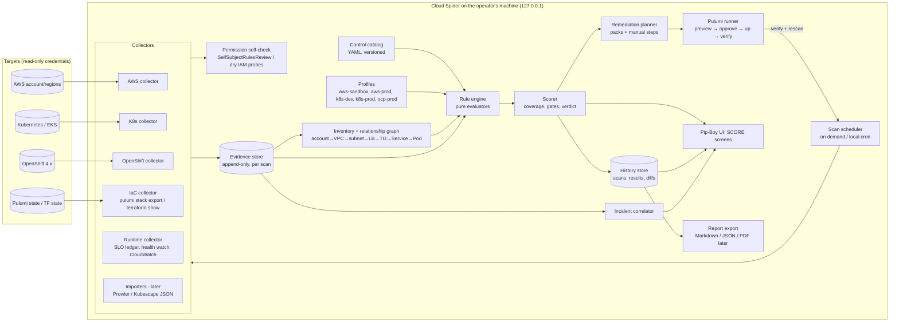
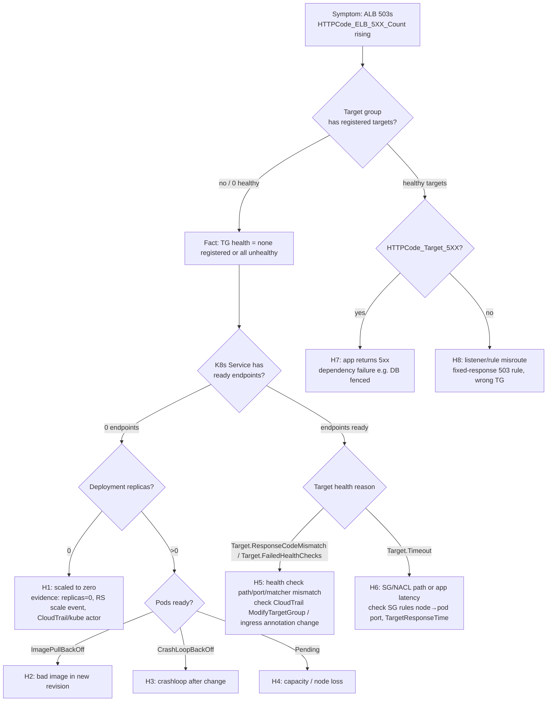
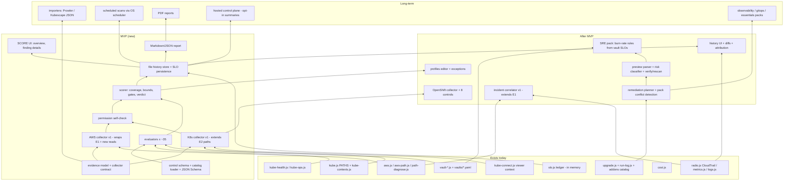

# Production Readiness Scorecard: technical design spec

| | |
|---|---|
| Status | **Proposed. Not approved. Nothing here is built yet.** Implementation waits for Gabriel's explicit approval of the strategy and the scope (see `docs/business/cloud-spider-platform-strategy.md` §15). |
| Author | Spider (Grok Bot for gabdzo), 2026-10-11 |
| Method | Superpowers `brainstorming` run headless (no user available; every question answered from the repo and the brief, assumptions recorded in §1.3). Then gstack `/plan-eng-review` (Appendix A). |
| Second opinion | PR #85 (Gabriel's terminal agent; closed in favour of #87, branch kept). Ideas taken from it are marked *adopted from PR #85*; strategy doc §15 lists adopted and rejected items. |
| Base | `main` at `82bc119` / #84 (2026-10-11 13:53 CEST), 482 tests passing per PR #84's description. Docs-only #86 (live test and disaster drill) read afterwards. |
| Companion | `docs/business/cloud-spider-platform-strategy.md` covers the commercial deliverables (1-4, 13, 14, 16-20). This document covers 5-12 and 15, plus effort (18) on the engineering side. |

> **Illustrative numbers warning.** Every scorecard, score, finding and resource name in this document is a **made-up example** to show how the method works. None of it is a measurement of a real account or cluster. Prices and standards are cited with links and the date they were read (2026-10-11).

---

## Contents

1. [Context, goals and non-goals](#1-context-goals-and-non-goals)
2. [Approaches considered (brainstorming)](#2-approaches-considered-brainstorming)
3. [Scorecard architecture (deliverable 5)](#3-scorecard-architecture-deliverable-5)
4. [Collectors and adapters: AWS, Kubernetes, OpenShift](#4-collectors-and-adapters-aws-kubernetes-openshift)
5. [Control catalog and machine-readable schema](#5-control-catalog-and-machine-readable-schema)
6. [Scoring methodology (deliverable 6)](#6-scoring-methodology-deliverable-6)
7. [Profiles](#7-profiles)
8. [Example scorecards (deliverables 7, 8, 9)](#8-example-scorecards-deliverables-7-8-9)
9. [Remediation and Pulumi platform packs (deliverable 10)](#9-remediation-and-pulumi-platform-packs-deliverable-10)
10. [Security and authorization model (deliverable 11)](#10-security-and-authorization-model-deliverable-11)
11. [Data collection and storage (deliverable 12)](#11-data-collection-and-storage-deliverable-12)
12. [Incident correlation and SRE operations (Phase 6)](#12-incident-correlation-and-sre-operations-phase-6)
13. [Dashboard UX (Phase 4)](#13-dashboard-ux-phase-4)
14. [Technical dependency map (deliverable 15)](#14-technical-dependency-map-deliverable-15)
15. [Effort estimates (deliverable 18, engineering view)](#15-effort-estimates-deliverable-18-engineering-view)
16. [Testing strategy](#16-testing-strategy)
17. [Open questions](#17-open-questions)
18. [Sources](#18-sources)
- [Appendix A: gstack /plan-eng-review record](#appendix-a-gstack-plan-eng-review-record)
- [Appendix B: Superpowers brainstorming record](#appendix-b-superpowers-brainstorming-record)

---

## 1. Context, goals and non-goals

### 1.1 What exists today (verified in code on `main`)

Cloud Spider is a local Node 20+ web app (`src/main.js`, `src/server.js` listens on `127.0.0.1:9241` only, `src/origin.js` rejects foreign origins on POSTs). The pieces this design reuses:

| Existing piece | File(s) | What it already does | Reuse for the scorecard |
|---|---|---|---|
| AWS discovery | `src/aws.js`, `src/aws-arch.js`, `src/aws-path.js` | EC2, VPC, subnets, route tables, IGW/NAT, VPC endpoints, peering, ENIs, SGs, ELBv2 (LBs, listeners, rules, TGs, target health, tags), EKS clusters and node groups, RDS instances, Lambda, Resource Groups Tagging API | Becomes the first **AWS collector**. 35 distinct AWS SDK commands are used today (counted with `grep "new …Command" src/*.js`). |
| ALB request-path diagnosis | `src/path-diagnose.js` (634 lines), `src/path-read.js` | Walks LB → listener → rule → TG → target → node → cluster and names the first broken edge, including LBC-managed stacks | Seed of the **incident correlator** (§12). |
| Read-only kube client | `src/kube.js` | Fixed allow-list of GET paths (`PATHS`), name validation (`checkName`), exec-plugin tokens, 8 s timeout | Becomes the **Kubernetes collector**. Needs more paths (RBAC, NetworkPolicy, PDB, PSA labels, CRDs, OpenShift APIs). |
| Multiple contexts, namespace scoping | `src/kube-contexts.js` | Several kube contexts, each limited to namespaces; first one is "primary" | Scope model for per-cluster and per-namespace scorecards. Live-test finding: SLOs only read the primary context (see §12.5). |
| Health watch | `src/kube-health.js` | CrashLoopBackOff, ImagePull, OOMKilled, failed Jobs, unready workloads, rising restarts, long Pending | Runtime evidence for Reliability and SRE controls. |
| OPS screen | `src/kube-ops.js` | Kyverno PolicyReports and ClusterPolicies, HPAs, Karpenter NodePools/NodeClaims, KEDA ScaledObjects, events | Evidence for Security (policy engine) and Reliability (autoscaling) controls. |
| SLOs | `src/slo.js` (`createSloLedger`, 5-min buckets, `BURN = {warn: 2, fast: 14.4}`) | SLI/SLO/error budget/burn from vault checks, ALB/Lambda/EC2 CloudWatch series, kube restarts | Runtime evidence for SRE controls. **Gap:** the ledger is an in-memory `Map`; history is lost on restart. |
| Vaults | `src/vault-*.js`, `vaults/*.yaml` | Backstage-style project definitions, ownership by tag/ID/stack, HTTP checks, TROUBLE from CloudTrail | The **application** scope (one scorecard per vault). |
| Stacks / add-ons | `src/upgrade.js`, `src/upgrade-rules.js`, `upgrades/*`, `upgrades/addons/catalog.js` | Spawns the `pulumi` CLI for preview/up/destroy, typed-name confirmation (`confirmMatches`), run logs on disk (`src/run-log.js`), add-on catalog with `detect`, `needs`, pod slots, cost | Base of the **remediation pack** runner (§9). |
| Kyverno baseline policies | `upgrades/addons/kyverno-policies.js` | Four Audit-mode Pod Security baseline policies, system namespaces excluded | First pack content ("Security pack v0"). |
| Cost | `src/cost.js`, `src/stack-costs.js` | Cost Explorer month-to-date, forecast, credits, disk cache; eu-north-1 price table read 2026-10-10 | FinOps evidence and pack cost estimates. |
| Monitoring | `src/logs.js`, `src/metrics.js`, `src/radio.js` | CloudWatch Logs, GetMetricData, CloudTrail LookupEvents | Observability evidence and change attribution. |
| Ask terminal | `src/agent.js`, `src/terminal.js` | Runs the user's own Cursor CLI in `--mode ask` with a ≤16,000-char map snapshot | Optional explainer on findings, never a decision maker. |
| Terraform PoC | `terraform/`, `src/terraform.js` | Read-only reader that allows only `show`, `output`, `version` | IaC-ownership evidence for Terraform-managed resources. |
| OpenShift | `upgrades/openshift` (CRC on EC2), `labs/ex280`, an OpenShift-shaped **sample** in `src/cluster.js` | OpenShift Local host and EX280 labs. **No live OpenShift API reads exist** in `src/` today. | The OpenShift adapter is new work. |

### 1.2 Goals

1. One **deterministic, explainable** readiness assessment per scope (account, region, environment, cluster, namespace, application/vault, optionally stack).
2. Evidence first: every finding links to the exact read that produced it, and a missing read is never a pass.
3. Separate **configuration posture** from **observed runtime reliability** (brief constraint 9).
4. Remediation through Pulumi only with **preview → explicit approval → apply → verify → rescan**.
5. Stay local-first: credentials and raw evidence never leave the machine in the MVP.

### 1.3 Non-goals (and headless assumptions)

- Not a compliance product. No claim of CIS/NIST/PCI compliance or certification; references are "aligned with" or "informed by".
- No automated root-cause analysis; the correlator ranks hypotheses with evidence and confidence (§12).
- No hosted SaaS in the MVP. §10.5 says what a later control plane would and would not receive.
- No agent running inside customer clusters in the MVP (pull from the operator's workstation with read-only credentials).
- No multi-cloud beyond AWS (TODOS.md already defers a second provider).
- **Assumptions made headless** (would have been brainstorming questions): (a) first user is Gabriel himself and then 3-5 consulting clients; (b) EKS first, OpenShift second, vanilla K8s third; (c) single operator per installation; (d) scans are on demand or scheduled locally, not continuous streaming; (e) report export (Markdown/JSON) matters more than a live fleet dashboard for the first paying users.

---

## 2. Approaches considered (brainstorming)

Three ways to build the engine were compared. The recommendation is **B**, with a later option of C's importers.

| | A. Hand-written checks inside the existing modules | **B. Separate scorecard core: YAML control metadata + pure JS evaluators + evidence store (recommended)** | C. Wrap existing OSS scanners (Prowler, Kubescape, Polaris, kube-bench) and only aggregate |
|---|---|---|---|
| Summary | Add `if`s to `aws.js`, `kube-ops.js`, etc. and show a score | New `src/score/` core with collector → evidence → evaluator → scorer pipeline; controls are data | Shell out to scanners, map their JSON to one schema |
| Effort | S at first, grows badly | M | M (but heavy external dependencies) |
| Explainability | Weak: logic spread across UI modules | Strong: one control = one YAML + one pure function + fixtures | Mixed: logic lives in other projects; rule semantics change with their releases |
| Coverage honesty (UNKNOWN vs PASS) | Hard; today's readers often return "nothing" on 403/404 (e.g. a missing CRD is "not installed") | Designed in: every evaluator receives evidence with an explicit `status` (ok / denied / error / absent) | Depends on each scanner's handling of permission errors |
| Cross-layer correlation (ALB ↔ Service ↔ pod) | Possible, ad hoc | Native: evidence graph shared with `path-diagnose.js` | Not possible; scanners are siloed per layer |
| Licensing / supply chain | None | None | Apache-2.0 for Prowler, Kubescape, Polaris and kube-bench (per their GitHub repos), but binary distribution, version pinning and update risk |
| Fits repo patterns | Partly; makes `server.js` (2,502 lines) and `browser.js` (4,409 lines) bigger | Yes: pure modules with sample data and `node --test`, like `slo.js`, `kube-health.js` | Partly; new runtime dependencies |

**Why B:** the differentiation is cross-layer evidence and honest coverage. Neither survives being spread through UI modules (A) or outsourced to siloed scanners (C). C's value, breadth of check content, can come later as **optional evidence importers** (`importer: prowler-json`, `importer: kubescape-json`) feeding the same evidence store, so a customer who already runs Prowler gets those results mapped instead of re-scanned. That keeps us from rewriting hundreds of commodity checks.

Rule language: **plain JS functions** (pure, unit-tested) over OPA/Rego or CEL. Rego and CEL are good but each is an extra runtime and an "innovation token" (gstack eng-review cognitive pattern 3), and the repo has no precedent for them. A control's evaluator stays small (typically 10-40 lines) and is tested with recorded evidence fixtures.

---

## 3. Scorecard architecture (deliverable 5)

### 3.1 Component view



### 3.2 Pipeline and state

```
scan request (scope, profile, catalog version)
   │
   ▼
[1 permission self-check] ──► records which reads are allowed/denied (evidence status "denied")
   │
   ▼
[2 collect] ── per collector, bounded concurrency, paginated, timeouts ──► evidence records
   │                                   (status: ok | denied | error | absent | truncated)
   ▼
[3 inventory] ── normalise resources + edges (owns, routes-to, selects, runs-on, managed-by)
   │
   ▼
[4 applicability] ── profile + inventory decide per control: applicable | NOT_APPLICABLE(reason)
   │
   ▼
[5 evaluate] ── pure evaluator(control, evidence slice) ──► per resource: PASS | FAIL | UNKNOWN(reason)
   │                                                   controls without a collector ► NOT_ASSESSED
   ▼
[6 score] ── category + overall scores, coverage, bounds, gates, verdict, confidence
   │
   ▼
[7 persist] ── scan record, results, diff vs previous scan, attribution hints (CloudTrail, Pulumi updates)
   │
   ▼
[8 present / export / plan remediation]
```

State machine of a scan:

```
QUEUED → CHECKING_PERMISSIONS → COLLECTING → EVALUATING → SCORED → (EXPORTED)
              │                     │             │
              └──── ABORTED ◄───────┴─────────────┘   (user cancel, credentials expired, fatal error)
PARTIAL: a collector timed out or was denied → scan still SCORED, affected controls UNKNOWN
```

A scan is never silently "complete": the record keeps `collectorsRun`, `collectorsFailed`, `readsDenied`, `truncated` so the UI and the report can show them.

### 3.3 Scopes

| Scope | Key | Built from | Example |
|---|---|---|---|
| Account | `aws:<accountId>` | Region scorecards + global (IAM, CloudTrail org trails, root signals) | `aws:550536272523` |
| Region | `aws:<accountId>/<region>` | Regional resources | `…/eu-north-1` |
| Environment | `env:<name>` | User mapping: accounts, regions, clusters, namespaces tagged with an environment (tag `environment=` or vault metadata) | `env:prod` |
| Cluster | `k8s:<contextOrArn>` / `ocp:<clusterID>` | Cluster-wide + all namespaces the credentials can read | `k8s:arn:aws:eks:…:cluster/cs-drill` |
| Namespace | `…/ns/<name>` | Namespaced controls only | `…/ns/shop` |
| Application | `vault:<name>` | Resources a vault owns (tags/ids/stack), across AWS and K8s | `vault:shopapi` |
| Stack (optional) | `stack:<project>/<stack>` | Resources in Pulumi state | `stack:cloudspider-upgrade/upgrade` |

A result belongs to one resource; scopes are views that filter results. So a failing readiness probe on `shop/shopapi` appears in the cluster, the namespace and the `vault:shopapi` scorecards, counted once in each.

---

## 4. Collectors and adapters: AWS, Kubernetes, OpenShift

### 4.1 Collector contract

```js
// src/score/collectors/<name>.js  (proposed; pure parts testable with recorded fixtures)
export const collector = {
  id: "aws-elbv2",
  version: "1",
  target: "aws",
  reads: [ // what it asks for; drives the permission self-check and the docs
    { api: "elasticloadbalancing:DescribeLoadBalancers", scope: "region" },
    { api: "elasticloadbalancing:DescribeTargetHealth", scope: "region" },
  ],
  async collect(ctx) { /* returns EvidenceRecord[] */ },
};
// EvidenceRecord
// { id, scanId, collector, read: "elasticloadbalancing:DescribeTargetHealth",
//   target: "aws:550536272523/eu-north-1", resource: "arn:aws:elasticloadbalancing:…",
//   status: "ok" | "denied" | "error" | "absent" | "truncated",
//   at: ISO time, durationMs, fields: { …only the fields controls need… },
//   sha256: hash of the raw response (raw not kept by default), error: { code, message } }
```

Rules every collector follows:

1. **403/AccessDenied → `denied`, never empty.** Today `kube.js` treats a missing CRD (404) as "not installed", which is correct for 404 but must be distinguished from 403 (forbidden), which means "we do not know".
2. **Pagination to the end or `truncated`.** The current `events?limit=500` read becomes `truncated` evidence if `metadata.continue` is set; controls depending on it are UNKNOWN for the missing part rather than PASS.
3. **Field minimisation.** Keep only the fields evaluators use. Never keep Secret data, env var values, ConfigMap data, log bodies (beyond bounded excerpts for incidents, local only), or IAM policy documents beyond the statements evaluated.
4. **Bounded concurrency and backoff** (AWS SDK adaptive retry; at most 4 parallel calls per service per region; kube at most 4 in flight per context).

### 4.2 AWS adapter

| Area | Reads (new ones in **bold**) | Example controls | Standards alignment |
|---|---|---|---|
| Security | **iam:GetAccountSummary, iam:GenerateCredentialReport/GetCredentialReport, iam:ListPolicies (local), iam:GetPolicyVersion, iam:ListAttachedRolePolicies**, **cloudtrail:DescribeTrails, GetTrailStatus**, **kms:ListKeys, DescribeKey, GetKeyRotationStatus**, ec2:DescribeSecurityGroups, **rds:DescribeDBInstances (have), DescribeDBSnapshotAttributes**, **s3:GetBucketPublicAccessBlock, GetBucketPolicyStatus, GetBucketEncryption**, **guardduty:ListDetectors, GetDetector**, **securityhub:DescribeHub, GetEnabledStandards** | root access keys present; root MFA; `*:*` customer policies; multi-region trail logging; RDS `PubliclyAccessible`; SG 0.0.0.0/0 on admin ports; S3 public access; encryption at rest; GuardDuty/Security Hub enabled | AWS Well-Architected Security pillar; Security Hub CSPM controls (e.g. [RDS.2] RDS public access, Critical); CIS AWS Foundations Benchmark (referenced, not claimed) |
| Reliability | elbv2 target health (have), EKS node groups (have), RDS MultiAZ/backup retention (have the instance read), **autoscaling:DescribeAutoScalingGroups**, **backup:ListBackupPlans, ListProtectedResources** | targets healthy in ≥2 AZs; RDS Multi-AZ (prod); backup retention ≥7 d; node groups across ≥2 AZs; single NAT dependency for multi-AZ workloads | AWS WA Reliability pillar; Security Hub [RDS.5], [RDS.11] |
| Networking | VPCs, subnets, route tables, IGW, NAT, endpoints, peering (all have), **route53:ListHostedZones**, listeners (have) | data stores in private subnets; HTTPS listener with redirect; VPC endpoints for S3/ECR (cost + egress); EKS API endpoint public access CIDRs | AWS WA Security + Reliability; Security Hub [RDS.46] |
| Observability | CloudWatch GetMetricData (have), Logs (have), **cloudwatch:DescribeAlarms**, **sns:ListSubscriptionsByTopic**, **logs:DescribeLogGroups**, **elbv2 DescribeLoadBalancerAttributes** | 5XX alarm with an action on each internet-facing ALB; log group retention set; ALB access logs on; alarm actions reach a subscribed endpoint | AWS WA Operational Excellence pillar |
| FinOps | Cost Explorer (have, us-east-1), **budgets:DescribeBudgets**, **ce:GetAnomalyMonitors**, tagging API (have) | budget with alert; cost allocation tags present; idle billed resources (unattached EIPs/EBS, stopped instances with volumes, idle NAT) | AWS WA Cost Optimization pillar |
| Governance | Pulumi `stack export` (have), Terraform `show -json` (have), tags (have) | IaC ownership share; env separation; drift (Pulumi `refresh --preview-only` is a write to nothing but **needs the user's deploy credentials**, so it is opt-in, NOT_ASSESSED by default) | AWS WA Operational Excellence |

Cost of a scan to the customer (AWS list prices, read 2026-10-11): Cost Explorer API requests are **$0.01 per paginated request** ([pricing](https://aws.amazon.com/aws-cost-management/aws-cost-explorer/pricing/)); GetMetricData is **$0.01 per 1,000 metrics requested** ([pricing](https://aws.amazon.com/cloudwatch/pricing/)). Most Describe/List calls carry no direct charge. A scan of one account/region should cost the customer cents; the scan budget is shown before a scheduled scan is enabled. (Unverified: whether every Describe call used is free in every region; the UI must say "estimated".)

### 4.3 Kubernetes adapter (EKS first)

New fixed GET paths on top of `src/kube.js` `PATHS`:

| Path | For |
|---|---|
| `/apis/rbac.authorization.k8s.io/v1/clusterroles`, `clusterrolebindings`, `roles`, `rolebindings` | RBAC controls (cluster-admin grants, wildcard verbs, `system:anonymous`/`system:unauthenticated` bindings) |
| `/api/v1/serviceaccounts` | `automountServiceAccountToken` |
| `/apis/networking.k8s.io/v1/networkpolicies` | default-deny presence per app namespace |
| `/apis/policy/v1/poddisruptionbudgets` | PDB coverage |
| `/apis/apiextensions.k8s.io/v1/customresourcedefinitions` | add-on detection, CRD ownership and versions (pack conflicts) |
| `/apis/admissionregistration.k8s.io/v1/validatingwebhookconfigurations`, `mutatingwebhookconfigurations` | policy engine overlap, failurePolicy risk |
| `/api/v1/namespaces` labels (have the list) | Pod Security Admission labels `pod-security.kubernetes.io/enforce` |
| `/apis/discovery.k8s.io/v1/endpointslices` | Service → ready endpoints (incident correlation) |
| `/apis/storage.k8s.io/v1/storageclasses`, `/api/v1/persistentvolumeclaims` | storage controls |
| `/apis/authorization.k8s.io/v1/selfsubjectrulesreviews` (POST, a read-only review) | permission self-check (the only non-GET; it creates nothing persistent) |
| `/version` | version-aware applicability |

The scanner role must read RBAC objects. Kubernetes' built-in `view` role does **not** (it "does not allow viewing roles or role bindings" and no Secrets; [Kubernetes RBAC user-facing roles](https://kubernetes.io/docs/reference/access-authn-authz/rbac/#user-facing-roles)), and EKS's `AmazonEKSViewPolicy` maps to view-level access, so a small extra ClusterRole is needed (§10.2).

Workload-level checks follow the [Pod Security Standards](https://kubernetes.io/docs/concepts/security/pod-security-standards/) (Baseline and Restricted field lists) and the [NSA/CISA Kubernetes Hardening Guide v1.2](https://www.nsa.gov/Press-Room/Digital-Media-Center/Document-Gallery/igphoto/2003066362/) themes (non-root, least privilege, network separation, logging). EKS specifics follow the [CIS Amazon EKS Benchmark](https://www.cisecurity.org/benchmark/kubernetes), which exists because the generic Kubernetes benchmark checks control-plane items that a managed service hides ([AWS blog](https://aws.amazon.com/blogs/containers/introducing-cis-amazon-eks-benchmark/)). Control-plane file permission checks (kube-bench territory) are **NOT_APPLICABLE on EKS** and NOT_ASSESSED elsewhere in the MVP.

### 4.4 OpenShift adapter (version-aware, not a copy of the K8s checks)

OpenShift 4 ships secure defaults that change what a "finding" is: the default SCC for new pods is `restricted-v2` (drops all capabilities, requires runtime/default seccomp) per [Red Hat OCP 4.19 SCC docs](https://docs.redhat.com/en/documentation/openshift_container_platform/4.19/html/authentication_and_authorization/managing-pod-security-policies); the platform runs its own monitoring stack; ingress is Routes via the IngressController; upgrades go through the Cluster Version Operator. So:

**Detection (adopted from PR #85).** A cluster is treated as OpenShift only after a successful live GET of `config.openshift.io/v1` `clusterversions/version`. A 404 makes every `OCP-*` control NOT_APPLICABLE (it is plain Kubernetes); a 403 makes them UNKNOWN. The OpenShift sample drawing in `src/cluster.js` and the CRC lab stack are never scored, and an OpenShift card never copies the Kubernetes score. Version-aware text comes from `ClusterVersion.status`, not a hard-coded version list.

| OpenShift area | Reads | Control logic (differs from vanilla K8s because…) | Reference |
|---|---|---|---|
| ClusterVersion and upgradeability | `config.openshift.io/v1 clusterversions/version` | `Failing`, `Progressing`, `Upgradeable=False` (blocks minor updates unless forced), channel, history, available updates. A cluster on an unsupported/EUS-mismatched channel is High. | [OCP 4.19 Understanding updates](https://docs.redhat.com/en/documentation/openshift_container_platform/4.19/html/updating_clusters/understanding-openshift-updates-1) |
| ClusterOperators | `config.openshift.io/v1 clusteroperators` | `Available=False` or `Degraded=True` is Critical (platform health gate). `Progressing=True` during an update is **not** a failure. | [ClusterOperator API 4.19](https://docs.redhat.com/en/documentation/openshift_container_platform/4.19/html/config_apis/clusteroperator-config-openshift-io-v1) |
| MachineConfigPools | `machineconfiguration.openshift.io/v1 machineconfigpools` | `Degraded=True`, `UpdatedMachineCount < MachineCount` for long, paused pools during updates | OCP 4.19 docs (Machine Config Operator) |
| SCCs | `security.openshift.io/v1 securitycontextconstraints` + RBAC `use` verbs + pod annotation `openshift.io/scc` | Flag `privileged`/`anyuid`/`hostaccess` **granted to application service accounts** or used by pods in non-platform namespaces. Pods in `openshift-*`, `kube-*` platform namespaces are excluded (they legitimately use privileged SCCs). Never recommend editing default SCCs (Red Hat says create a custom SCC instead). | [OCP 4.19 SCC docs](https://docs.redhat.com/en/documentation/openshift_container_platform/4.19/html/authentication_and_authorization/managing-pod-security-policies) |
| Pod Security Admission | namespace labels | OpenShift syncs PSA labels with SCCs; evaluate the synced label, do not demand manual labels | [OCP 4.19 PSA](https://docs.redhat.com/en/documentation/openshift_container_platform/4.19/html/authentication_and_authorization/understanding-and-managing-pod-security-admission) |
| OAuth / IdP | `config.openshift.io/v1 oauths/cluster`, `kube-system/kubeadmin` secret **existence** (metadata only via a scoped `get` is not possible without secret read, so: UNKNOWN unless the operator confirms) | IdP configured; kubeadmin removed after an IdP exists (Red Hat post-install guidance) | OCP 4.19 post-installation docs |
| RBAC | `rbac` + `project.openshift.io` | self-provisioner binding as intended; cluster-admin grants; `cluster-reader` is the recommended scanner role (no Secrets) | [OCP 4.19 RBAC](https://docs.redhat.com/en/documentation/openshift_container_platform/4.19/html/authentication_and_authorization/using-rbac) |
| Operators / OLM | `operators.coreos.com/v1alpha1 subscriptions, clusterserviceversions, installplans` | CSV phase `Failed`, manual InstallPlans pending, operators on deprecated channels | OCP 4.19 Operators docs |
| Routes / ingress | `route.openshift.io/v1 routes`, `operator.openshift.io/v1 ingresscontrollers` | Routes without TLS (edge/reencrypt/passthrough) for external hosts; default IngressController replicas ≥2 on multi-node | OCP 4.19 Networking docs |
| Monitoring | `openshift-monitoring/cluster-monitoring-config` ConfigMap (needs a scoped read), `monitoring.coreos.com` CRs | User workload monitoring enabled (`enableUserWorkload: true`); **no second Prometheus stack** (Red Hat says remove custom Prometheus instances before enabling UWM); Alertmanager receivers configured | [OCP 4.19 Configuring user workload monitoring](https://docs.redhat.com/en/documentation/monitoring_stack_for_red_hat_openshift/4.19/html-single/configuring_user_workload_monitoring/index) |
| etcd | `operator.openshift.io/v1 etcds/cluster` conditions | etcd operator health is readable; **backup evidence usually is not** (backups are a host-level `cluster-backup.sh` run or a scheduled backup feature depending on version). Default result: UNKNOWN with a clear "provide evidence" action. | OCP 4.19 Backup and restore docs |
| Network isolation | NetworkPolicy, `network.operator.openshift.io` | app projects have NetworkPolicies; multitenant isolation mode where used | OCP 4.19 Networking docs |

Version awareness: every OpenShift control declares `appliesTo.ocpVersion: ">=4.12 <4.20"` (example), and the collector reads `clusterversion.status.desired.version`. A control outside its range is NOT_APPLICABLE with reason `version-out-of-range`, and the catalog gets a new revision when Red Hat changes behaviour. CIS publishes a separate Red Hat OpenShift Container Platform benchmark ([CIS Kubernetes benchmarks page](https://www.cisecurity.org/benchmark/kubernetes)); we reference it but do not claim to implement it.

Test target: the existing `upgrades/openshift` stack (OpenShift Local/CRC on EC2, about $0.43/h while running per RUN-ME §12) plus recorded fixtures. CRC is single-node, so multi-node controls are NOT_APPLICABLE there, which is itself a useful test of applicability.

---

## 5. Control catalog and machine-readable schema

### 5.1 Schema (YAML, validated with a JSON Schema in `schemas/control.schema.json`, proposed)

```yaml
# Control schema v1 (field reference)
apiVersion: cloudspider.dev/v1alpha1     # catalog API version
kind: Control
id: AWS-SEC-001                          # stable; never reused
revision: 3                              # bumps when logic or severity changes; results record id@revision
title: RDS instances are not publicly accessible
category: security                       # security | reliability | networking | observability | finops | governance | sre | platform
target: aws                              # aws | kubernetes | openshift
resourceTypes: [AWS::RDS::DBInstance]
evidenceType: config                     # config (posture) | runtime (observed behaviour) | process (human-provided evidence)
appliesTo:                               # applicability, evaluated before the evaluator runs
  when: "inventory.has('AWS::RDS::DBInstance')"   # otherwise NOT_APPLICABLE(reason: no-resources)
  versions: {}                           # e.g. {kubernetes: ">=1.25", ocp: ">=4.12 <4.20"}
requires:                                # reads needed; a denied read makes the result UNKNOWN
  - collector: aws-rds
    reads: ["rds:DescribeDBInstances"]
evaluator: aws/rds-public-access         # pure JS function in src/score/evaluators/
aggregation: all-or-nothing              # all-or-nothing | proportional  (see §6.3)
severity:                                # default + per-profile overrides
  default: critical
  profiles: {aws-sandbox: high}
gate:                                    # critical-risk gate membership per profile
  profiles: [aws-production]
confidence: high                         # high (direct field) | medium (derived/joined) | low (inferred from absence)
references:                              # alignment, not compliance claims
  - {source: "AWS Security Hub CSPM", id: "RDS.2", url: "https://docs.aws.amazon.com/securityhub/latest/userguide/rds-controls.html"}
  - {source: "AWS Well-Architected", id: "SEC05", url: "https://docs.aws.amazon.com/wellarchitected/latest/framework/welcome.html"}
whyItMatters: >
  A publicly accessible instance has a public DNS name that resolves to a public IP. With a
  permissive security group the database port is reachable from the internet.
remediation:
  summary: Set PubliclyAccessible=false and restrict the security group to the VPC / app SGs.
  effort: S                              # S (<1h) | M (≤1d) | L (>1d)
  operationalRisk: medium                # low | medium | high (what can break while fixing)
  automated: pulumi-modify               # none | pulumi-pack:<id> | pulumi-modify (only for stacks Cloud Spider owns)
  manualSteps:
    - "aws rds modify-db-instance --db-instance-identifier <id> --no-publicly-accessible --apply-immediately"
  docs: ["https://docs.aws.amazon.com/AmazonRDS/latest/UserGuide/Overview.DBInstance.Modifying.html"]
verification:
  rescan: [AWS-SEC-001]
  criteria: "DescribeDBInstances shows PubliclyAccessible=false for the instance"
```

Result record (one per control × resource):

```yaml
result:
  scanId: 2026-10-11T12-00-00Z-7f3a
  control: AWS-SEC-001@3
  resource: arn:aws:rds:eu-north-1:111122223333:db:shopdb      # illustrative
  scope: [aws:111122223333, aws:111122223333/eu-north-1, vault:shopapi, env:prod]
  status: FAIL            # PASS | FAIL | UNKNOWN | NOT_APPLICABLE | NOT_ASSESSED
  reason: null            # required for UNKNOWN / NOT_APPLICABLE / NOT_ASSESSED, e.g. "denied:rds:DescribeDBInstances"
  severity: critical      # after profile overrides
  confidence: high
  evidence: [ev-91c2]     # evidence record ids
  observed: {PubliclyAccessible: true, VpcSecurityGroups: [sg-0abc]}
  firstSeen: 2026-10-04T08:00:00Z
  exception: null         # or {id, approvedBy, expires, justification}
```

### 5.2 Example controls (real checks, illustrative wording)

Ten controls across the three targets. Severities are ours (profile defaults) and may differ from a cited source; where Security Hub publishes a severity it is noted.

```yaml
---
id: AWS-SEC-010
revision: 1
title: A multi-Region CloudTrail trail is logging management events
category: security
target: aws
evidenceType: config
appliesTo: {when: "true"}
requires: [{collector: aws-cloudtrail, reads: ["cloudtrail:DescribeTrails", "cloudtrail:GetTrailStatus", "cloudtrail:GetEventSelectors"]}]
evaluator: aws/cloudtrail-multiregion
aggregation: all-or-nothing          # account-level control: one result per account
severity: {default: high}
gate: {profiles: [aws-production]}
confidence: high
references:
  - {source: "AWS Security Hub CSPM", id: "CloudTrail.1", url: "https://docs.aws.amazon.com/securityhub/latest/userguide/cloudtrail-controls.html"}
whyItMatters: Without a logging trail there is no record of who changed what, which also blinds Cloud Spider's change attribution.
remediation: {summary: "Create or enable an organization or multi-Region trail with management events.", effort: S, operationalRisk: low, automated: none}
verification: {rescan: [AWS-SEC-010], criteria: "IsMultiRegionTrail=true and IsLogging=true and management events included"}
---
id: AWS-REL-001
revision: 1
title: Each internet-facing ALB target group has healthy targets in at least two Availability Zones
category: reliability
target: aws
evidenceType: runtime               # observed state at scan time, not configuration
appliesTo: {when: "resource.scheme == 'internet-facing' && profile.multiAz"}
requires: [{collector: aws-elbv2, reads: ["elasticloadbalancing:DescribeTargetGroups", "elasticloadbalancing:DescribeTargetHealth"]}, {collector: aws-ec2, reads: ["ec2:DescribeSubnets"]}]
evaluator: aws/alb-healthy-azs
aggregation: proportional
severity: {default: high, profiles: {aws-sandbox: info}}
confidence: high
references:
  - {source: "AWS Well-Architected Reliability pillar", url: "https://docs.aws.amazon.com/wellarchitected/latest/reliability-pillar/welcome.html"}
whyItMatters: One AZ or one target is a single point of failure; the drill's "node loss" fault took the only target out.
remediation: {summary: "Run ≥2 replicas spread across zones (topologySpreadConstraints) and node groups in ≥2 AZs.", effort: M, operationalRisk: low, automated: none}
verification: {rescan: [AWS-REL-001, K8S-REL-004], criteria: "healthy targets span ≥2 AZs in two consecutive scans"}
---
id: AWS-OBS-001
revision: 1
title: Internet-facing ALBs have a 5XX alarm with an action
category: observability
target: aws
evidenceType: config
appliesTo: {when: "resource.type == 'application' && resource.scheme == 'internet-facing'"}
requires: [{collector: aws-cloudwatch, reads: ["cloudwatch:DescribeAlarms"]}, {collector: aws-sns, reads: ["sns:ListSubscriptionsByTopic"]}]
evaluator: aws/alb-5xx-alarm
aggregation: proportional
severity: {default: medium}
confidence: medium                  # alarm may watch a math expression we cannot fully resolve
whyItMatters: >
  The ALB's own 503s (no healthy target) appear in HTTPCode_ELB_5XX_Count, not in target metrics;
  PR #83 found RequestCount 0 next to 1,189 ELB 5XX in the same period during the drill.
remediation: {summary: "Alarm on HTTPCode_ELB_5XX_Count and HTTPCode_Target_5XX_Count (or an SLO burn alert) routed to a subscribed SNS topic.", effort: S, operationalRisk: low, automated: "pulumi-pack:sre"}
verification: {rescan: [AWS-OBS-001], criteria: "alarm exists in OK/ALARM state with ≥1 action whose topic has ≥1 confirmed subscription"}
---
id: K8S-SEC-001
revision: 2
title: No privileged containers outside system namespaces
category: security
target: kubernetes
evidenceType: config
appliesTo: {when: "namespace not in profile.systemNamespaces"}   # kube-system, kyverno, karpenter, … (same list as kyverno-policies.js SKIP_NAMESPACES + profile additions)
requires: [{collector: k8s-core, reads: ["GET /api/v1/pods"]}]
evaluator: k8s/no-privileged
aggregation: all-or-nothing
severity: {default: critical, profiles: {k8s-development: medium}}
gate: {profiles: [k8s-production]}
confidence: high
references:
  - {source: "Kubernetes Pod Security Standards (Baseline: Privileged Containers)", url: "https://kubernetes.io/docs/concepts/security/pod-security-standards/"}
  - {source: "NSA/CISA Kubernetes Hardening Guide v1.2", url: "https://www.nsa.gov/Press-Room/Digital-Media-Center/Document-Gallery/igphoto/2003066362/"}
whyItMatters: A privileged container disables most isolation; a compromise becomes a node compromise.
remediation: {summary: "Remove securityContext.privileged; add only the capability needed.", effort: M, operationalRisk: medium, automated: "pulumi-pack:security (Kyverno Audit policy to report; Enforce only after review)"}
verification: {rescan: [K8S-SEC-001], criteria: "no pod outside system namespaces has privileged=true in any container"}
---
id: K8S-REL-002
revision: 1
title: Containers that serve traffic have a readiness probe
category: reliability
target: kubernetes
evidenceType: config
appliesTo: {when: "workload is selected by a Service with ports"}   # uses the inventory graph (Service selector → pods)
requires: [{collector: k8s-core, reads: ["GET /apis/apps/v1/deployments", "GET /api/v1/services"]}]
evaluator: k8s/readiness-probe
aggregation: proportional
severity: {default: high, profiles: {k8s-development: low}}
confidence: high
whyItMatters: Without readiness, a starting or broken pod receives traffic; the ALB sees healthy targets that return errors.
remediation: {summary: "Add readinessProbe (httpGet on a cheap health path).", effort: S, operationalRisk: low, automated: none}
verification: {rescan: [K8S-REL-002], criteria: "every container behind a Service has readinessProbe"}
---
id: K8S-SRE-002
revision: 1
title: Each production SLO has multiwindow burn-rate alerting
category: sre
target: kubernetes
evidenceType: config
appliesTo: {when: "vault.slos.length > 0"}
requires: [{collector: vaults, reads: ["file:vaults/*.yaml"]}, {collector: k8s-monitoring, reads: ["GET /apis/monitoring.coreos.com/v1/prometheusrules"]}]
evaluator: sre/burn-rate-alerts
aggregation: proportional
severity: {default: medium}
confidence: medium
references:
  - {source: "Google SRE Workbook, Alerting on SLOs (14.4×/1h+5m, 6×/6h+30m, 1×/3d+6h)", url: "https://sre.google/workbook/alerting-on-slos/"}
whyItMatters: Cloud Spider's burn lamps only light while the page is open; an alert must page someone when nobody is looking.
remediation: {summary: "Generate recording + alert rules for the SLO (SRE pack).", effort: S, operationalRisk: low, automated: "pulumi-pack:sre"}
verification: {rescan: [K8S-SRE-002], criteria: "PrometheusRule (or CloudWatch alarm pair) exists for both page windows and the ticket window"}
---
id: OCP-PLT-001
revision: 1
title: All ClusterOperators are Available and not Degraded
category: platform
target: openshift
evidenceType: runtime
appliesTo: {versions: {ocp: ">=4.12"}}
requires: [{collector: ocp-config, reads: ["GET /apis/config.openshift.io/v1/clusteroperators"]}]
evaluator: ocp/clusteroperators-healthy
aggregation: all-or-nothing
severity: {default: critical}
gate: {profiles: [openshift-production]}
confidence: high
references:
  - {source: "Red Hat OCP 4.19 ClusterOperator API", url: "https://docs.redhat.com/en/documentation/openshift_container_platform/4.19/html/config_apis/clusteroperator-config-openshift-io-v1"}
whyItMatters: A Degraded operator means a platform component persistently differs from its desired state and can block updates.
remediation: {summary: "Investigate with `oc get co`, `oc describe co <name>`; follow Red Hat's operator-specific guidance. Cloud Spider never changes platform operators.", effort: M, operationalRisk: high, automated: none}
verification: {rescan: [OCP-PLT-001], criteria: "Available=True and Degraded=False for all operators (Progressing during an update is allowed)"}
---
id: OCP-SEC-001
revision: 1
title: Application service accounts are not granted privileged or anyuid SCCs
category: security
target: openshift
evidenceType: config
appliesTo: {when: "namespace !~ /^(openshift|kube)-/ && namespace not in profile.systemNamespaces"}
requires: [{collector: ocp-security, reads: ["GET /apis/security.openshift.io/v1/securitycontextconstraints", "GET /apis/rbac.authorization.k8s.io/v1/rolebindings", "GET /api/v1/pods"]}]
evaluator: ocp/app-sa-scc
aggregation: proportional
severity: {default: high}
confidence: medium                  # SCC admission picks the SCC at pod creation; we read the openshift.io/scc annotation plus grants
references:
  - {source: "Red Hat OCP 4.19 Managing SCCs", url: "https://docs.redhat.com/en/documentation/openshift_container_platform/4.19/html/authentication_and_authorization/managing-pod-security-policies"}
whyItMatters: anyuid/privileged undo restricted-v2's defaults (non-root UID range, dropped capabilities, seccomp).
remediation: {summary: "Fix the image to run as an arbitrary UID; if a capability is truly needed, create a custom SCC rather than editing defaults.", effort: M, operationalRisk: medium, automated: none}
verification: {rescan: [OCP-SEC-001], criteria: "no app pod annotated openshift.io/scc in {privileged, anyuid, hostaccess, hostmount-anyuid}"}
---
id: OCP-UPG-001
revision: 1
title: ClusterVersion is upgradeable and on a supported channel
category: platform
target: openshift
evidenceType: config
requires: [{collector: ocp-config, reads: ["GET /apis/config.openshift.io/v1/clusterversions/version"]}]
evaluator: ocp/upgradeable
aggregation: all-or-nothing
severity: {default: high}
confidence: high
references:
  - {source: "Red Hat OCP 4.19 Understanding OpenShift updates", url: "https://docs.redhat.com/en/documentation/openshift_container_platform/4.19/html/updating_clusters/understanding-openshift-updates-1"}
whyItMatters: Upgradeable=False blocks minor updates unless forced; staying behind accumulates CVEs and support risk.
remediation: {summary: "Resolve the condition named in Upgradeable's message (often a deprecated API in use or an operator condition).", effort: M, operationalRisk: medium, automated: none}
verification: {rescan: [OCP-UPG-001], criteria: "Upgradeable is not False and spec.channel is a supported channel for the version"}
```

### 5.3 MVP catalog size

The MVP ships **about 35-40 controls**: ~15 AWS, ~15 Kubernetes/EKS, ~8 OpenShift (preview). The full Phase 2 list in the brief is around 120+ controls and is the long-term catalog. Choosing which 35 is part of validation: the first three paid assessments decide which findings customers act on.

**Stub controls (adopted from PR #85).** A control that is in the profile but has no collector yet ships as a **stub**: metadata only, `blockedBy: "<API or collector that would assess it>"` (e.g. `blockedBy: "iam:GenerateCredentialReport"`), result always NOT_ASSESSED. Stubs keep the coverage maths honest from day one: an account scanned by an MVP that cannot see IAM shows that gap as missing weight instead of silently leaving it out of the denominator. A stub is not a promise to build the collector; the `blockedBy` text tells the user (and the roadmap) exactly what is missing.

**Controls adopted from PR #85** (ids rewritten to this catalog's scheme; inputs verified on `main`):

| Id | Check | Input that exists today | Notes |
|---|---|---|---|
| AWS-SEC-012 | Security group allows `0.0.0.0/0` or `::/0` to an admin port: tcp 22, 3389, **10250 (kubelet)** | `DescribeSecurityGroups` (`src/aws-path.js`) | Critical in AWS Production (gate candidate), High in AWS Sandbox. The kubelet port is easy to forget and #85 was right to list it |
| AWS-REL-010 | Load balancer has listeners **and zero healthy targets** | target health on the path (`src/path-diagnose.js`) | Runtime, High. Also fixes drill finding 9 (HURTING said "0 of 0 targets" while the ALB served 503s) |
| AWS-REL-011 | EKS cluster status is not `ACTIVE` | cluster status already on the path | Runtime, High |
| AWS-INF-001 | Path stops before the pod (no Service/Pod join for this target) | `diagnose()` output | **Informational, weight 0.** Records the boundary so nobody reads path health as pod health (#85 eng finding 3) |
| K8S-REL-008 | HPA exists but the metrics API answers 404 (metrics-server absent) | `PATHS.hpas`, `PATHS.podMetrics` | Medium. A 403 on the metrics API is UNKNOWN, not FAIL |
| K8S-SEC-009 | Kyverno PolicyReport has `fail` results | `PATHS.policyReports`, `clusterPolicyReports` | Severity inherited from the policy (`policies.kyverno.io/severity`). If the PolicyReport CRD answers 404, this control is NOT_APPLICABLE and the separate "an admission policy engine is installed" control (K8S-PLT-001, the one the security pack in §9.3 targets) is the one that fails; see §6.1 for why this differs from #85 |
| OCP-SEC-004 | A Route exposes an admin or console endpoint publicly | `route.openshift.io/v1` Routes | Preview. Routes, not only Ingress |
| OCP-PLT-003 | etcd backup evidence | operator-provided record or a scoped read | Already in §8.3. Adopted #85's rule: **never PASS from a viewer role**; without evidence it is UNKNOWN |

**Read paths the MVP must add (verified):** `PATHS` in `src/kube.js` has no NetworkPolicy, PodDisruptionBudget, ResourceQuota, LimitRange or RBAC lists today. Each new GET path goes in as **its own small task** in the implementation plan so a reviewer can accept or reject it alone (adopted from #85). Until a path exists, the controls that need it are stubs (NOT_ASSESSED).

---

## 6. Scoring methodology (deliverable 6)

### 6.1 Result states (constraint 2)

| State | Meaning | In score numerator | In score denominator | In coverage denominator |
|---|---|---|---|---|
| `PASS` | Evidence read, requirement met | yes (×1) | yes | yes |
| `FAIL` | Evidence read, requirement not met (fully or partly) | partial credit only for `proportional` controls | yes | yes |
| `UNKNOWN` | Control applies, **we tried** and could not decide: read denied (403/AccessDenied), API error, timeout, truncated list, telemetry missing | **no** (never treated as pass, constraint 1) | no (score); shown in bounds | yes |
| `NOT_ASSESSED` | Control applies but **was not attempted**: no collector yet, collector disabled by the user, opt-in read not enabled (e.g. drift needs deploy creds), process evidence not provided | no | no (score); shown in bounds | yes |
| `NOT_APPLICABLE` | Control does not apply: no such resource, profile excludes it, version out of range, platform makes it moot (control-plane file checks on EKS) | no | **no** | **no** (constraint 3) |

**Empty lists (adopted from PR #85).** An empty list is not a PASS unless the control explicitly declares the empty state as healthy (`emptyIs: pass`, e.g. "no IAM users with console access and no MFA"). Otherwise an empty list means the control has nothing to evaluate: zero load balancers makes every ALB control NOT_APPLICABLE (`reason: no-resources`), never PASS.

**403 vs 404.** A 403/AccessDenied on an attempted read is UNKNOWN (the user can fix it by granting the read). A 404 on an optional CRD means "that add-on is not installed" (as `src/kube.js` already comments); the control that needs the CRD becomes NOT_APPLICABLE and the control that asks *whether* such an add-on should exist decides FAIL or PASS. PR #85 folds both into NOT_ASSESSED; this spec keeps them apart because each tells the user a different next step.

The difference between UNKNOWN and NOT_ASSESSED (constraint 4) matters for the fix: UNKNOWN is usually solved by **granting a read** or turning on telemetry; NOT_ASSESSED by **building a collector or enabling an opt-in**. They are reported separately with their own coverage share.

### 6.2 Weights

```
severity weight  w_sev:  Critical 40 · High 15 · Medium 5 · Low 2 · Informational 0
profile multiplier m:   0 (=NOT_APPLICABLE) · 0.5 · 1 · 1.5 · 2      (per control or category, from the profile)
control weight   w = w_sev × m
```

Why 40/15/5/2: one Critical outweighs 20 Lows, one High outweighs 7 Lows (constraint 6), and the ratios are round enough to explain on a whiteboard. Informational findings are shown but weigh nothing.

### 6.3 Per-control pass fraction

For a control evaluated over `n` assessed resources with `k` passing:

```
proportional:     p = k / n                       (e.g. 16 of 20 deployments have readiness → p = 0.8)
all-or-nothing:   p = 1 if k == n else 0          (all Critical controls and account-level controls)
```

Resources that are UNKNOWN inside a control: if any resource is UNKNOWN and none FAIL, the control is UNKNOWN; if some FAIL and some are UNKNOWN, the control is FAIL with `p = k / n_assessed` and the UNKNOWN share is counted in coverage. So a partial read never upgrades a control to PASS.

### 6.4 Category score, coverage and bounds

For category `c`, over **applicable** controls `A_c` (everything except NOT_APPLICABLE), assessed controls `S_c ⊆ A_c` (PASS or FAIL), unknown `U_c`, not assessed `N_c`:

```
earned_c   = Σ_{i∈S_c} w_i · p_i
Score_c    = 100 · earned_c / Σ_{i∈S_c} w_i                       (evidence-based score)
Coverage_c = Σ_{i∈S_c} w_i / Σ_{i∈A_c} w_i
Unknown_c  = Σ_{i∈U_c} w_i / Σ_{i∈A_c} w_i
NotAss_c   = Σ_{i∈N_c} w_i / Σ_{i∈A_c} w_i                         (Coverage + Unknown + NotAss = 100 %)
Lower_c    = 100 · earned_c / Σ_{i∈A_c} w_i                        (every unknown would fail)
Upper_c    = 100 · (earned_c + Σ_{i∈U_c∪N_c} w_i) / Σ_{i∈A_c} w_i  (every unknown would pass)
```

The score is shown **with its bounds**, e.g. `83 (59–88)`. The width of the bracket is exactly how much the unknowns could move it (constraint 5). A category with `Coverage_c < minCategoryCoverage` (profile) **or fewer than 3 assessed controls** shows `INSUFFICIENT_EVIDENCE` instead of a number and does not enter the overall score. The control-count floor (adopted from PR #85) stops one heavy control from giving a category 100 % weight coverage on its own.

### 6.5 Overall score, verdict and gates

```
Overall      = Σ_c W_c · Score_c / Σ_c W_c          over categories that met minCategoryCoverage
Coverage_all = Σ_c W_c · Coverage_c / Σ_c W_c       over ALL categories (an insufficient category drags coverage down)
(Unknown_all, NotAss_all and the bounds are aggregated the same way.)
```

`W_c` are profile category weights (e.g. AWS Production: Security 30, Reliability 25, Networking 15, Observability 15, Governance 10, FinOps 5).

Verdict, evaluated in this order (constraints 7, 8, 10):

| # | Condition | Verdict | Overall number shown? |
|---|---|---|---|
| 1 | `Coverage_all < minCoverage` (profile), or fewer than **8** applicable controls assessed in the scope (floor adopted from PR #85) | **INSUFFICIENT_EVIDENCE** | **No.** Only coverage, the categories that qualify, and the list of reads to grant. |
| 2 | any gate control `FAIL` | **BLOCKED** | Yes, greyed, never green, with "GATED" |
| 3 | `Overall < 60` | **AT RISK** | Yes |
| 4 | any gate `UNKNOWN`/`NOT_ASSESSED`, or `Overall < 80`, or (production profile and no runtime evidence: <7 days of SLO data or no SLO defined) | **CONDITIONAL** | Yes |
| 5 | otherwise | **NO KNOWN BLOCKERS** | Yes |

There is deliberately **no "READY" or "COMPLIANT" verdict** (constraint 8). The best a checklist can say is that it found no blockers in what it could see. Every report carries the line: *"This scorecard checks configuration and recent observed behaviour against a control catalog. It is not proof of production readiness and not a compliance attestation."*

**The number is never shown without the verdict** (adopted from PR #85: "a UI that shows the number without the gate is a bug"). Every surface (overview tile, export, JSON summary, notification) carries verdict + coverage + number together, in that order, and a test enforces it for the exporters.

The score is **not capped** when a gate fails: capping would make the number non-monotonic and hide progress on the other findings. The gate controls the verdict and the colour; the number stays honest.

### 6.6 Posture vs runtime (constraint 9)

Each control carries `evidenceType`:

- `config`: configuration posture (probe defined, SG rule, encryption flag).
- `runtime`: observed behaviour over a window (SLO attainment, error budget left, burn rate, target health right now, restarts, recovery drill outcome).
- `process`: human-provided evidence (restore test record, runbook URL that resolves, on-call rota).

The scorecard shows **two sub-scores per category where both exist**: `Posture` and `Runtime`, plus the combined category score. A cluster with perfect probes but a spent error budget shows `Posture 95 · Runtime 40`. In the production profiles, the verdict cannot be better than CONDITIONAL without runtime evidence (rule 4 above). Runtime evidence today comes from `src/slo.js` (needs persistence, §11) and the health watch.

### 6.7 Confidence

Per finding: `high` (direct read of the decisive field), `medium` (join or heuristic: tag-based ownership, alarm math we cannot fully resolve, LBC-managed resource attribution), `low` (inferred from absence: "no alarm found" when alarms may live in another region or account).

Per scorecard:

```
HIGH   if Coverage_all ≥ 85 % and Unknown_all ≤ 10 % and ≥ 80 % of FAIL weight has high-confidence findings
MEDIUM if Coverage_all ≥ minCoverage
LOW    otherwise (this coincides with INSUFFICIENT_EVIDENCE)
```

### 6.8 Remediation priority

```
priority = w_sev × exposure × confidence_factor ÷ effort_points
exposure:          2.0 internet-reachable · 1.5 production data store · 1.0 otherwise
confidence_factor: 1.0 high · 0.7 medium · 0.4 low
effort_points:     S = 1 · M = 2 · L = 4
Gate failures always sort first, then by priority, then by firstSeen (oldest first).
```

### 6.9 Versioning, history and trends

- Catalog has a semantic version (`catalog: 2026.10.0`); each control has `revision`. A scan records both, and the profile version.
- **Trend comparisons only compare like with like**: a delta between two scans with different catalog versions is split into "changed because the environment changed" and "changed because the rules changed" (re-evaluate the old evidence with the new catalog where the evidence suffices; otherwise mark the delta as `rules-changed`).
- History keeps per scan: overall/category scores and bounds, coverage, verdict, the result set, and diffs (opened, resolved, regressed = resolved then failing again, flapping = changed state ≥3 times in 7 days).
- Change attribution: a diff entry is annotated with nearby CloudTrail events touching the resource (already read by `src/radio.js`), Pulumi update history for owning stacks, and Kubernetes ReplicaSet revisions. Attribution is labelled **"possible cause (time correlation)"**, never "cause".

### 6.10 Worked examples

All numbers below are illustrative and reproducible from the formulas (the arithmetic was checked with a small script).

**Example 1: category score with UNKNOWN and NOT_ASSESSED (Kubernetes Production, Reliability)**

| Control | Sev | w | State | p | w·p |
|---|---|---:|---|---:|---:|
| K8S-REL-001 requests/limits (18/20) | M | 5 | FAIL | 0.90 | 4.5 |
| K8S-REL-002 readiness probes (16/20) | H | 15 | FAIL | 0.80 | 12.0 |
| K8S-REL-003 PDB for replicas>1 (3/6) | M | 5 | FAIL | 0.50 | 2.5 |
| K8S-REL-004 nodes in ≥2 zones | H | 15 | PASS | 1.00 | 15.0 |
| K8S-REL-005 topology spread (4/10) | L | 2 | FAIL | 0.40 | 0.8 |
| K8S-REL-006 HPA on stateless services | L | 2 | UNKNOWN (metrics API forbidden for the viewer) | – | – |
| K8S-REL-007 PV backups | H | 15 | NOT_ASSESSED (no Velero/AWS Backup collector yet) | – | – |

- Applicable weight = 59; assessed weight = 42; earned = 34.8.
- Score = 100 × 34.8 / 42 = **82.9 → 83**.
- Coverage = 42/59 = **71.2 %**; Unknown = 2/59 = **3.4 %**; Not assessed = 15/59 = **25.4 %**.
- Bounds: lower = 100 × 34.8/59 = **59.0**; upper = 100 × (34.8+17)/59 = **87.8** → shown as `83 (59–88)`.
- Reading: the 83 rests on 71 % of the weight; the missing backup evidence alone could pull it to 59. Coverage ≥ 50 % so the category is scored.

**Example 2: N/A excluded from denominators**

An AWS Production account with **no NAT gateway** (all private subnets use VPC endpoints): AWS-REL-005 "one NAT per AZ" (M, w=5) is `NOT_APPLICABLE(reason: no-resources)`. Reliability then has applicable weight 60, not 65. If it had been counted as FAIL the score would drop from 50.0 to 46.2 (30/65) for a control that cannot apply; if counted as PASS it would rise to 53.8 (35/65), for no reason. Excluding it is the only honest option.

**Example 3: a critical gate overrides a high score (constraints 6 and 7)**

AWS Production, Security category: 30 controls pass with total weight 560; one Critical control fails, AWS-SEC-001 (RDS `PubliclyAccessible=true` with SG `0.0.0.0/0:5432` on 1 of 3 instances, all-or-nothing → p = 0).

- Score = 100 × 560 / 600 = **93.3**. Coverage 100 %.
- Gate AWS-SEC-001 = FAIL → verdict **BLOCKED**. The 93 is shown greyed with "GATED · 1 critical"; the remediation list starts with the database.
- Same account, but the critical replaced by 20 Low failures (w = 2 each, 40 total, same weight): score is also 93.3, but there is no gate failure, so the verdict is CONDITIONAL (93 ≥ 80, but production without runtime evidence), and the priority list ranks them as 20 small items. The number alone would not tell these two accounts apart; the gate and the verdict do.

**Example 4: INSUFFICIENT_EVIDENCE (constraint 10)**

AWS Production, but the scan role lacks `rds:Describe*`, `iam:*` reads, `guardduty:*`, `ce:*` and `budgets:*`. Per category (score is computed only over assessed weight):

| Category | W | Coverage | Unknown | Not assessed | Category result |
|---|---:|---:|---:|---:|---|
| Security | 30 | 21 % | 79 % | 0 % | INSUFFICIENT_EVIDENCE |
| Reliability | 25 | 50 % | 50 % | 0 % | 100 (50–100) |
| Networking | 15 | 100 % | 0 % | 0 % | 81 |
| Observability | 15 | 29 % | 41 % | 29 % | INSUFFICIENT_EVIDENCE |
| FinOps | 5 | 0 % | 100 % | 0 % | INSUFFICIENT_EVIDENCE |
| Governance | 10 | 0 % | 67 % | 33 % | INSUFFICIENT_EVIDENCE |

- Coverage_all = **38.1 %** (unknown 54.1 %, not assessed 7.7 %) < 70 % → verdict **INSUFFICIENT_EVIDENCE**, no overall number.
- If we had computed it anyway over the two qualifying categories, the "score" would be **92.9**: a confident-looking number built on 38 % of the evidence, with both Critical security controls unknown. This is the failure mode constraint 1 exists to prevent.
- The screen instead lists "Grant these reads to assess 62 % more of the weight": `rds:DescribeDBInstances`, `iam:GetAccountSummary`, `iam:GenerateCredentialReport`, …

**Example 5: UNKNOWN vs NOT_ASSESSED in the same scorecard**

OpenShift Production (§8.3): `OCP-PLT-003 etcd backup evidence` is **UNKNOWN** because the evidence lives on control-plane hosts the read-only role cannot see (fix: provide a backup record or grant a scoped read of the backup CronJob namespace). `OCP-PLT-004 platform certificate expiry` is **NOT_ASSESSED** because the collector is not built yet (fix: product roadmap). Both widen the bounds; only the first is something the customer can fix today, so they are listed separately.

---

## 7. Profiles

A profile changes **applicability**, **severity**, **multipliers**, **gates** and **coverage thresholds**. Profiles are versioned YAML (`profiles/aws-production.yaml`, proposed).

| | AWS Sandbox | AWS Production | Kubernetes Development | Kubernetes Production | OpenShift Production |
|---|---|---|---|---|---|
| minCoverage / minCategoryCoverage | 40 % / 30 % | 70 % / 50 % | 40 % / 30 % | 70 % / 50 % | 70 % / 50 % |
| Category weights | Security 40, FinOps 30, Governance 15, Networking 10, Observability 5, Reliability 0 (N/A) | Security 30, Reliability 25, Networking 15, Observability 15, Governance 10, FinOps 5 | Security 40, Reliability 20, Platform 20, Observability 20, SRE 0 | Security 30, Reliability 30, Observability 15, SRE 15, Platform 10 | Platform health 30, Security 25, Reliability 20, Observability 15, Ingress 10 |
| Not applicable here | multi-AZ, RDS Multi-AZ, backups ≥7 d, NAT per AZ, alarm routing | – | PDB, multi-zone, topology spread, burn-rate alerts, runbooks | – | control-plane file checks, things OpenShift manages (default SCC content, router internals) |
| Severity changes | public exposure stays Critical; most reliability → Info | defaults | privileged → Medium; readiness → Low; NetworkPolicy → Low | defaults | SCC grants High; platform namespaces excluded from workload checks |
| Gates | root access keys; public DB/snapshot; `*:*` policy on a role usable from outside the account | + multi-region CloudTrail; automated backups on data stores (encryption at rest is High, not a gate, because it cannot be fixed in place for RDS and would block for weeks) | none (report only) | no privileged app pods; no cluster-admin to SA/default/anonymous; API endpoint not open to 0.0.0.0/0 without auth controls (EKS) | ClusterOperators healthy; MCPs not Degraded; etcd backup evidence; no privileged SCC on app SAs |
| Runtime evidence required for best verdict | no | yes (SLO data ≥7 d on vault-owned public endpoints) | no | yes | yes |
| FinOps emphasis | high (idle spend, budget alert; the repo's own TODOS.md asks for a $10 budget alert) | low | – | – | – |

How a profile is chosen: by the scope's environment mapping (tag `environment=prod`, a vault's `metadata.tags`, or the user picks). **If no environment is set, the production profile applies and the report says so** (adopted from PR #85): guessing "dev" from a name like `test-eks` would loosen gates on what may be production; the stricter default fails safe. Mixed environments in one account (sandbox and prod in the same account) are themselves a Governance finding (AWS-GOV-002) in the production profile.

---

## 8. Example scorecards (deliverables 7, 8, 9)

> **All three scorecards below are illustrative examples** with invented resources and results. They show the layout and the arithmetic, not a real environment.

### 8.1 Example AWS scorecard (AWS Production profile)

```
╔═ SCORECARD · aws:111122223333/eu-north-1 · profile aws-production@1 · catalog 2026.10.0 ═══════╗
║ VERDICT  BLOCKED  (gate AWS-SEC-001 failed)              SCORE 46 (41–54)  ░ GATED            ║
║ COVERAGE 85.5 %   UNKNOWN 6.8 %   NOT ASSESSED 7.7 %      CONFIDENCE HIGH                      ║
╚═══════════════════════════════════════════════════════════════════════════════════════════════╝
```

| Category | W | Score (bounds) | Coverage | Unknown | Not assessed | Notes |
|---|---:|---|---:|---:|---:|---|
| Security | 30 | 65 (56–70) | 86 % | 14 % | 0 % | RDS public (Critical, gate FAIL); encryption 3/4 data stores; GuardDuty and IAM wildcard checks UNKNOWN (reads denied) |
| Reliability | 25 | 50 | 100 % | 0 % | 0 % | ALB targets in one AZ; RDS single-AZ; backups OK; node groups 2 AZ; NAT-per-AZ N/A |
| Networking | 15 | 41 | 100 % | 0 % | 0 % | EKS API endpoint public to 0.0.0.0/0; HTTP listener without redirect; no S3/ECR endpoints |
| Observability | 15 | 8 (6–35) | 71 % | 0 % | 29 % | No ALB 5XX alarm; no access logs; log retention on 1 of 2 groups; alarm routing NOT_ASSESSED |
| Governance | 10 | 43 (29–62) | 67 % | 0 % | 33 % | 86 % of resources owned by a stack or tag; prod and test share the account; drift NOT_ASSESSED (opt-in) |
| FinOps | 5 | INSUFFICIENT_EVIDENCE | 47 % | 53 % | 0 % | Budget read denied; excluded from overall |

Overall = (30·65.0 + 25·50.0 + 15·40.5 + 15·8.3 + 10·43.0) / 95 = **45.9** (FinOps excluded). Gate list: AWS-SEC-001 FAIL; AWS-SEC-002 root keys PASS; AWS-SEC-010 CloudTrail PASS; backups PASS; encryption at rest FAIL is High but not a gate in this profile version.

Top findings (priority order):

| # | ID | Resource | Sev | Conf | Evidence | Remediation | Effort | Auto? |
|---|---|---|---|---|---|---|---|---|
| 1 | AWS-SEC-001 | `db:shopdb` | Critical (gate) | high | `DescribeDBInstances`: `PubliclyAccessible: true`; `sg-0abc` allows `0.0.0.0/0:5432` | Make private; restrict SG to app SG | S | modify (owned stack only) |
| 2 | AWS-NET-004 | `cluster/prod-eks` | High | high | `DescribeCluster`: `endpointPublicAccess: true`, `publicAccessCidrs: [0.0.0.0/0]` | Restrict CIDRs or private endpoint | S | modify (owned stack only) |
| 3 | AWS-REL-001 | `tg/shop-api` | High | high | `DescribeTargetHealth`: 2 healthy, both `eu-north-1a` | Spread replicas/node groups across AZs | M | no |
| 4 | AWS-REL-002 | `db:shopdb` | High | high | `MultiAZ: false` | Enable Multi-AZ (cost shown: roughly doubles instance cost) | S | modify |
| 5 | AWS-OBS-001 | `alb/shop` | Medium | medium | `DescribeAlarms`: no alarm on `HTTPCode_ELB_5XX_Count` for this LB | SRE pack: ALB 5XX + burn alerts | S | pulumi-pack:sre |

### 8.2 Example Kubernetes scorecard (Kubernetes Production profile, EKS)

```
╔═ SCORECARD · k8s:arn:aws:eks:eu-north-1:111122223333:cluster/prod-eks · k8s-production@1 ════╗
║ VERDICT  CONDITIONAL  (score < 80)                        SCORE 78 (64–80)                   ║
║ COVERAGE 83.8 %   UNKNOWN 1.0 %   NOT ASSESSED 15.2 %     CONFIDENCE MEDIUM                    ║
║ POSTURE 72 · RUNTIME 100 (SLO met 30 d on 2 of 3 services; 1 has no SLO)                    ║
╚═══════════════════════════════════════════════════════════════════════════════════════════════╝
```

| Category | W | Score (bounds) | Coverage | Unknown | Not assessed | Notes |
|---|---:|---|---:|---:|---:|---|
| Security | 30 | 78 (69–80) | 89 % | 0 % | 11 % | Gates pass (no privileged app pods, no cluster-admin to SAs); PSA labels on 2 of 4 app namespaces; no default-deny NetworkPolicy; image vulns NOT_ASSESSED (no scanner data) |
| Reliability | 30 | 83 (59–88) | 71 % | 3 % | 25 % | Example 1 above |
| Observability | 15 | 71 | 100 % | 0 % | 0 % | metrics API, logging and tracing pipelines healthy (OTel collector); no Alertmanager route |
| SRE | 15 | 68 | 100 % | 0 % | 0 % | 2 of 3 services have SLOs; no burn-rate alerting outside the UI; no runbook links; observed SLO met (runtime) |
| Platform | 10 | 86 (50–92) | 58 % | 0 % | 42 % | Kyverno in Audit; GitOps NOT_ASSESSED; cert-manager N/A (not installed, no TLS secrets managed in-cluster) |

Overall = (30·77.8 + 30·82.9 + 15·70.6 + 15·68.1 + 10·85.7)/100 = **77.5**. Gates: K8S-SEC-001 PASS, K8S-SEC-002 PASS. Verdict CONDITIONAL because 77.5 < 80 (and a backup gate candidate is NOT_ASSESSED, shown as a note).

Top findings: K8S-SEC-005 no default-deny NetworkPolicy in `shop`, `web` (High, S, pack: security, Audit first); K8S-REL-002 4 of 20 containers behind Services have no readiness probe (High, S, manual); K8S-SEC-003 PSA `enforce` label missing on `shop`, `jobs` (High, S, manual with dry-run `warn` first); K8S-SRE-002 no burn-rate alerts (Medium, S, pack: sre); K8S-OBS-004 no alert route (Medium, S, pack: observability **only if no existing alerting**, see §9.4).

### 8.3 Example OpenShift scorecard (OpenShift Production profile)

```
╔═ SCORECARD · ocp:7d3c…e21 (4.18.x, stable-4.18) · openshift-production@1 ═══════════════════╗
║ VERDICT  CONDITIONAL  (gate OCP-PLT-003 etcd backup evidence UNKNOWN)   SCORE 78 (66–82)     ║
║ COVERAGE 84.5 %   UNKNOWN 14.2 %   NOT ASSESSED 1.3 %     CONFIDENCE MEDIUM                    ║
╚═══════════════════════════════════════════════════════════════════════════════════════════════╝
```

| Category | W | Score (bounds) | Coverage | Unknown | Not assessed | Notes |
|---|---:|---|---:|---:|---:|---|
| Platform health | 30 | 79 (48–87) | 61 % | 35 % | 4 % | ClusterOperators healthy (gate PASS); MCPs healthy; **Upgradeable=False** (deprecated API in use); etcd backup evidence UNKNOWN (gate UNVERIFIED); platform cert expiry NOT_ASSESSED |
| Security | 25 | 78 | 100 % | 0 % | 0 % | 1 of 4 app SAs uses `anyuid`; IdP configured; kubeadmin removed (operator-confirmed); NetworkPolicy in 2 of 4 app projects |
| Reliability | 20 | 80 | 100 % | 0 % | 0 % | readiness 90 %; PDBs 50 %; workers-in-≥2-zones N/A (on-prem single site) |
| Observability | 15 | 67 (50–75) | 75 % | 25 % | 0 % | user workload monitoring on; **no duplicate Prometheus**; Alertmanager has no receivers; log forwarding UNKNOWN |
| Ingress | 10 | 90 | 100 % | 0 % | 0 % | 4 of 5 external Routes use TLS; default IngressController has 2 replicas |

Overall = (30·78.6 + 25·78.5 + 20·80 + 15·66.7 + 10·90)/100 = **78.2**. Note the OpenShift-specific judgement: pods in `openshift-*` using privileged SCCs are **not** findings; UWM rather than a second Prometheus is the recommended path; Cloud Spider proposes **no automated change** to ClusterOperators, MCPs or the IngressController.

---

## 9. Remediation and Pulumi platform packs (deliverable 10)

### 9.1 Principles

1. **Integrate before install.** If a capability already exists (any Prometheus, any policy engine, any GitOps controller), the default is **ADOPT** (use it as an evidence source and map controls to it) or **SKIP**, never a second install.
2. **Never replace supported OpenShift platform components.** On OpenShift, packs use Red Hat's supported paths (user workload monitoring, OperatorHub operators such as Red Hat OpenShift GitOps or the cert-manager Operator for Red Hat OpenShift) and never touch `openshift-*` platform operators, the default IngressController, default SCCs or the platform monitoring stack.
3. **Every write is preview → explicit approval → apply → verify → rescan.** Approval is a typed confirmation of the stack name (the existing `confirmMatches` pattern in `src/upgrade-rules.js`), shown next to the parsed preview.
4. **Destructive operations and CRD upgrades are high-risk** and need a second, separate confirmation with the blast radius spelled out.
5. **Packs fix controls, not vibes.** Each pack declares the control IDs it is expected to move (`fixes:`); verification re-runs exactly those controls plus the pack's own health checks.

### 9.2 Pack definition (extends `upgrades/addons/catalog.js`)

```yaml
apiVersion: cloudspider.dev/v1alpha1
kind: Pack
id: security-baseline
version: 0.3.0
title: Security pack (Kyverno + baseline policies, Audit mode)
targets:
  kubernetes: {versions: ">=1.28 <1.34", distributions: [eks, generic]}
  openshift: unsupported          # OpenShift has SCC + PSA sync; Kyverno is optional and not installed by us there
components:
  - {id: kyverno, kind: helm, chart: kyverno, repo: "https://kyverno.github.io/kyverno/", chartVersion: "3.9.1", appVersion: "v1.19.1"}   # pinned as in catalog.js today
  - {id: baseline-policies, kind: manifests, source: upgrades/addons/kyverno-policies.js, mode: Audit}
prerequisites: [metrics-server?, "free pod slots ≥ 3 (pod-room.js check)"]
detect:                            # existing-installation detection (read-only)
  crds: [clusterpolicies.kyverno.io, constrainttemplates.templates.gatekeeper.sh]
  deployments: [kyverno/kyverno-admission-controller]
  webhooks: [kyverno-resource-validating-webhook-cfg, gatekeeper-validating-webhook-configuration]
  labels: {"app.kubernetes.io/managed-by": Helm}   # plus meta.helm.sh/release-name annotation on CRDs
decision:                          # what the planner proposes for each detection result
  absent: INSTALL
  same-tool-ours: UPGRADE          # stack exists in our Pulumi state
  same-tool-foreign: ADOPT         # Kyverno installed by someone else → read its reports, do not touch
  other-engine: SKIP_WITH_FINDING  # Gatekeeper present → map controls to Gatekeeper constraints, report overlap risk
fixes: [K8S-PLT-001, K8S-SEC-001, K8S-SEC-004]   # Audit policies make these visible; they do not "pass" them
permissions:
  kubernetes: "cluster-admin during install (CRDs, webhooks); the scanner role stays read-only"
  aws: none
cost: {fixed: [], note: "3 pods; on a t4g.small node that is most of the free slots (pod-room.js)"}
verify:
  - deployment kyverno/kyverno-admission-controller Available
  - validating webhook answers a server-side dry-run create of a sample Pod (dry-run persists nothing)
  - PolicyReports appear within 5 min for ≥1 namespace
rollback: "pulumi destroy of the policies stack first; Kyverno itself only after CR count = 0 (see destroy safeguards)"
upgrade: "chart minor upgrades via preview; CRD changes handled as a separate high-risk step (§9.5)"
ownership: {stack: "security-baseline-<cluster>", tags: {project: security-baseline, managed-by: pulumi, cloudspider-pack: "0.3.0"}}
```

### 9.3 The five packs

| Pack | Components (EKS / generic K8s) | OpenShift path | Prereqs | Detect existing | Default decision when found | Cost notes (illustrative, eu-north-1 list prices from `src/stack-costs.js` where available) |
|---|---|---|---|---|---|---|
| **Security** | Kyverno (pinned chart), 4 baseline Audit policies (exist today), optional PSA labels in `warn` mode | Do not install Kyverno by default; produce SCC/PSA findings; optional "Kyverno on OpenShift" only on explicit opt-in | pod slots | Kyverno, Gatekeeper, Kubewarden CRDs and webhooks | ADOPT / SKIP_WITH_FINDING | No AWS cost; 3 pods |
| **Observability** | OTel Collector (exists in `upgrades/demo` via ADOT), metrics-server (exists), optional kube-prometheus-stack, Loki, Tempo, Grafana | **Enable user workload monitoring** (ConfigMap change via an approved, previewed step) + OpenShift Logging/Loki operator if absent. Never a second Prometheus. | storage class for Loki/Tempo PVCs; S3 for object storage | Any Prometheus (`monitoring.coreos.com` CRDs, `prometheus-*` StatefulSets), Datadog/Grafana/New Relic/Dynatrace agents (DaemonSets by known names/labels), CloudWatch Container Insights add-on, OpenShift monitoring | **SKIP** if any existing metrics/alerting stack is found; propose only gaps (e.g. SLO rules into the existing Prometheus) | EBS gp3 PVCs and S3; node capacity is the real cost and must be shown before apply |
| **SRE** | SLO recording + multiwindow burn-rate alert rules generated from `vault.yaml` SLOs (14.4×/6×/1× per Google SRE Workbook), alert routing (Alertmanager receiver or CloudWatch alarm → SNS), runbook links | PrometheusRule objects in user workload monitoring; Alertmanager for user-defined projects if enabled | an alerting backend (existing preferred) | existing PrometheusRules with same SLO names; existing CloudWatch alarms | ADOPT (link existing) or INSTALL rules only | CloudWatch alarms have per-alarm charges (see [CloudWatch pricing](https://aws.amazon.com/cloudwatch/pricing/)); Prometheus rules free beyond compute |
| **GitOps** | Argo CD (pinned chart), app-of-apps template, drift view (read Argo `Application` sync status as evidence) | **Red Hat OpenShift GitOps** operator via OLM Subscription | ingress or port-forward for UI | Argo CD / Flux CRDs | ADOPT (read sync/drift status) | pods only |
| **Platform essentials** | cert-manager (pinned), External Secrets Operator **or** Secrets Store CSI (one, not both), ingress (AWS LBC exists in `upgrades/addons/lbc.js`), backups (Velero or AWS Backup plan) | cert-manager Operator for Red Hat OpenShift; OpenShift API for Data Protection (OADP) for backups; Routes instead of an ingress controller | IAM roles via Pod Identity (exists: `pod-identity.js`) | cert-manager/ESO/CSI CRDs; existing IngressClasses; Velero CRDs; AWS Backup plans | ADOPT; never a second ingress controller for the same class | Backup storage and snapshots; Route 53 zone $0.50/month if ExternalDNS (plan-expansion.md open question 6) |

### 9.4 Conflict detection (before any preview)

| Conflict | How detected (read-only) | Planner result |
|---|---|---|
| Duplicate monitoring | ≥1 Prometheus/agent already scraping (CRDs, StatefulSets, DaemonSets, OpenShift monitoring present) | Block INSTALL of a metrics stack; offer "add SLO rules to the existing one" |
| Two admission policy engines | Gatekeeper and Kyverno webhooks both present or proposed | Block; explain double-enforcement and webhook latency/failurePolicy risk |
| CRD owned by another release | CRD annotation `meta.helm.sh/release-name` ≠ our release, or `app.kubernetes.io/managed-by` ≠ Helm/Pulumi | ADOPT only; never take ownership |
| CRD version skew | stored versions (`status.storedVersions`) vs chart's CRD versions | Mark CRD upgrade as high-risk step (§9.5) |
| IngressClass collision | same `controller` / default class annotation | Block a second default class |
| Namespace collision | target namespace exists without our labels | Ask to use another namespace or ADOPT |
| OpenShift platform component | target in `openshift-*` or a platform CR (IngressController default, cluster-monitoring stack) | Refuse; show the Red Hat-supported path |
| Pod/node capacity | existing `pod-room.js` check, node allocatable | Block with "needs N pod slots; node has M" (exists for Kyverno today) |
| Recommendation already satisfied (adopted from PR #85) | catalog `detect` says the add-on is running (e.g. Kyverno), or OCP-PLT monitoring control is PASS | **Do not recommend** installing it (no "install Kyverno" when Kyverno runs; no metrics stack on OpenShift when the platform monitoring stack is healthy); recommend configuring the existing one instead |

### 9.5 Preview, approval, CRD and destroy safeguards

```
plan ─► pulumi preview --json --diff --stack <pack>-<cluster>
          │ parse steps: create / update / replace / delete / same
          ▼
     risk classifier:
       delete or replace of: CustomResourceDefinition, Namespace, PersistentVolumeClaim,
         StatefulSet with PVCs, Secret not created by us, IAM role in use  → HIGH
       CRD spec change (new storage version, removed version)          → HIGH (separate step)
       webhook with failurePolicy=Fail                                  → MEDIUM (cluster-wide blast radius)
       everything else                                                  → normal
          ▼
     UI: preview table + risk badges + cost delta + "what this fixes" (control IDs)
          ▼
     approval: type the stack name (normal) / type the stack name AND the resource name (HIGH)
          ▼
     pulumi up --yes (spawned like upgrade.js today, run log on disk)
          ▼
     verify: pack health checks + rescan of `fixes:` controls (+ the full scope in the background)
          ▼
     record: before/after result per control, Pulumi update id, who approved, when
```

- **CRDs:** Helm installs CRDs from `crds/` only on first install and does not upgrade or delete them ([Helm CRD best practices](https://helm.sh/docs/chart_best_practices/custom_resource_definitions/)). Packs therefore manage CRDs as a separate Pulumi component with `protect: true`, upgraded only as an explicit, separately confirmed step after a server-side dry-run. Never delete a CRD to "update" it: that deletes every CR of that kind.
- **Destroy:** `retainOnDelete` for CRDs and namespaces holding user CRs; destroy refused while CRs of the pack's kinds exist (e.g. Kyverno ClusterPolicies not created by us, cert-manager Certificates, Argo Applications), unless the user types the count and the kind. Policies stack destroys before the engine stack (dependency order is already how `addon-bundle.js` installs).
- **Ownership:** a pack only ever changes resources in its own stack. "Modify" remediations (e.g. making an RDS instance private) are offered only for resources that a Cloud Spider-known stack owns (vault `spec.stack` / Pulumi state). For anything else the remediation is a **manual step with the exact command**, as the README's Ask terminal already does for non-Cloud-Spider commands.
- **Upgrade strategy:** pinned versions in the catalog (as today); a catalog bump produces a preview that shows the chart/app version delta and links release notes; no auto-upgrades.
- **Rollback:** `pulumi stack history` + re-apply previous pack version; for Helm releases the Pulumi `helm.v3.Release` keeps history. Data-bearing components (Loki, Tempo, Velero backups) document that rollback does not restore deleted data.

---

## 10. Security and authorization model (deliverable 11)

### 10.1 Threat model (short)

| Asset | Threat | Mitigation |
|---|---|---|
| Cloud credentials / kubeconfigs | Exfiltration via the app, a malicious page, or a hosted backend | Credentials never leave the machine; server binds `127.0.0.1`; origin check on every POST (exists, `src/origin.js`); no hosted component in MVP |
| Scanner abused to write | Bug or injected request uses scanner creds to mutate | Scanner uses **separate read-only identities**; permission self-check warns (and in prod profile refuses unless overridden) when the scanner identity **can** write (`SelfSubjectRulesReview` shows create/update/delete; IAM: probe a harmless dry-run like `ec2:RunInstances --dry-run` returns `DryRunOperation` = can write) |
| Remediation runs the wrong change | Mis-scoped stack, stale preview | Remediation uses the **user's own deploy identity**, explicit typed approval, preview hash must match the applied plan (re-preview if older than 10 min or if the stack changed) |
| Evidence leaks secrets | Logs, env vars, ConfigMaps contain secrets | Field minimisation (§4.1); no Secret reads; existing `src/report.js` redaction patterns (`AKIA…`, secret-like keys) applied to every stored string; log excerpts only in incident view, local, bounded |
| Prompt injection via cluster data into the Ask agent | A pod name/annotation instructs the agent | Agent stays `--mode ask`, proposals become buttons into normal flows (exists); scorecard data passed as data, never instructions |
| Supply chain of packs | Malicious chart version | Pinned versions + repo URLs in the catalog; checksum where available; preview always shows versions |

### 10.2 Least-privilege roles per target

**AWS scanner role** (`CloudSpiderScanner`, assumed with an external ID for client accounts):

- Attach AWS managed **`SecurityAudit`** (read config and metadata for security auditing) and **`ViewOnlyAccess`** job-function policies ([AWS managed policies for job functions](https://docs.aws.amazon.com/IAM/latest/UserGuide/access_policies_job-functions.html)), plus a small inline policy for `ce:GetCostAndUsage*`, `ce:GetCostForecast`, `cloudwatch:GetMetricData`, `logs:FilterLogEvents` on named log groups only.
- Add **explicit denies** for data-plane reads: `s3:GetObject`, `secretsmanager:GetSecretValue`, `ssm:GetParameter*`, `kms:Decrypt`, `dynamodb:GetItem/Query/Scan`, `rds-data:*`, `lambda:InvokeFunction`.
- No write actions at all. The existing EC2 stop/start on `cloudspider=expendable` instances stays with the user's own profile, not the scanner.
- Unverified detail to confirm during build: the exact action lists inside `SecurityAudit`/`ViewOnlyAccess` change over time; the self-check reports what the role can actually do rather than trusting the policy names.

**Kubernetes/EKS scanner** (`cloudspider-scanner` group via an EKS access entry, or a ServiceAccount token for generic clusters):

```yaml
# illustrative ClusterRole; bound together with AmazonEKSViewPolicy (EKS) or the built-in "view" ClusterRole
apiVersion: rbac.authorization.k8s.io/v1
kind: ClusterRole
metadata: {name: cloudspider-scanner-extra}
rules:
  - apiGroups: ["rbac.authorization.k8s.io"]
    resources: [roles, rolebindings, clusterroles, clusterrolebindings]
    verbs: [get, list]
  - apiGroups: [""]
    resources: [nodes, namespaces, serviceaccounts]
    verbs: [get, list]
  - apiGroups: ["apiextensions.k8s.io"]
    resources: [customresourcedefinitions]
    verbs: [get, list]
  - apiGroups: ["admissionregistration.k8s.io"]
    resources: [validatingwebhookconfigurations, mutatingwebhookconfigurations]
    verbs: [get, list]
  - apiGroups: ["metrics.k8s.io"]
    resources: [pods, nodes]
    verbs: [get, list]
  - apiGroups: ["wgpolicyk8s.io", "kyverno.io", "karpenter.sh", "keda.sh", "monitoring.coreos.com", "argoproj.io"]
    resources: ["*"]
    verbs: [get, list]
  # deliberately absent: secrets (any verb), pods/exec, pods/portforward, any write verb
```

The existing `CONNECT` flow (`src/kube-connect.js`) already writes a viewer kubeconfig context; it would gain this extra ClusterRole via the metrics-server/viewer add-on path that PR #82 started.

**OpenShift scanner:** a ServiceAccount (or group) bound to the default **`cluster-reader`** ClusterRole, which can view most objects and **cannot read Secrets** ([OCP 4.19 RBAC](https://docs.redhat.com/en/documentation/openshift_container_platform/4.19/html/authentication_and_authorization/using-rbac)), plus `get` on the `openshift-monitoring/cluster-monitoring-config` ConfigMap if not already covered. Onboarding runs `oc auth can-i --list` (via SelfSubjectRulesReview) and shows the result.

### 10.3 Where credentials live

- AWS: the user's existing AWS CLI profiles / SSO cache; Cloud Spider only names a profile and a role ARN to assume (as `upgrade.js` uses `AWS_PROFILE` today). No keys stored by Cloud Spider.
- Kubernetes: kubeconfig contexts (exec plugins such as `aws eks get-token`), as `src/kube.js` does today.
- Nothing is written to the evidence or history store except identity **ARNs/names** used and the self-check result.

### 10.4 Authorization inside the app

Single local operator in the MVP. Write endpoints (remediation, stacks) keep the origin check and typed confirmation; scheduled scans are read-only by construction. For a later TEAM tier, approvals require a second person (four-eyes) and are recorded in the audit history.

### 10.5 A hosted control plane: what it would and would not receive

Not part of the MVP. If built later (model D in the strategy doc), the local app stays the only thing that talks to customer infrastructure, and pushes **outbound only**.

| Would receive (opt-in, per workspace) | Would never receive |
|---|---|
| Scan summaries: verdict, scores, bounds, coverage, category breakdown | Cloud credentials, role session tokens, kubeconfigs, Pulumi access tokens or passphrases |
| Finding records: control ID, severity, status, timestamps, **resource identifiers** (ARNs/names; optional salted hashing per workspace) | Raw API responses / evidence bodies |
| Exception and approval records (who, when, why, expiry) | Log lines, env vars, ConfigMap/Secret contents, IAM policy documents |
| Remediation outcomes: pack id/version, before/after control states, Pulumi update id | Pulumi state files or stack outputs |
| Catalog/profile versions used | Anything that could trigger a write: the hosted side can **request** a scan or show a plan, but approvals and applies happen only in the local app |

---

## 11. Data collection and storage (deliverable 12)

### 11.1 Collection cadence

| Mode | Trigger | Notes |
|---|---|---|
| On-demand scan | SCAN key in the UI / `npm run scan -- --scope … --profile …` (proposed CLI) | Default for MVP |
| Scheduled scan | local timer while Cloud Spider runs (later: OS scheduler via a small CLI) | Shows estimated AWS API cost per run before enabling |
| Continuous signals | existing pollers (map 1 s EC2 poll, kube 60 s, SLO buckets 5 min) | Feed runtime evidence; not full scans |
| Post-remediation | automatic after `pulumi up` | Re-runs `fixes:` controls, then the scope |

### 11.2 Storage layout (local, under the repo-independent data dir)

Default `~/.cloudspider/` (override `CLOUDSPIDER_DATA_DIR`), directory `0700`, files `0600` (file mode adopted from PR #85), never in the git checkout; if a user points the data dir inside a repo, the app writes a `.gitignore` there and warns:

```
~/.cloudspider/
  scans/2026/10/11/<scanId>/
    scan.json            # scope, profile@v, catalog@v, identities, collectors run/failed, timings, verdict, scores
    evidence.jsonl.gz    # minimised evidence records (append-only)
    results.jsonl.gz     # one line per control × resource
  index.jsonl            # one line per scan (for history lists and trends without opening every scan)
  slo/<key>.jsonl        # SLO ledger buckets persisted (fixes the in-memory-only gap in src/slo.js)
  exceptions.yaml        # accepted risks: control, resource selector, justification, approver, expiry
  remediation/<runId>.json   # preview hash, approval, Pulumi update id, verify results (run logs stay in src/run-log.js format)
```

Why files and not a database for the MVP: zero native dependencies (the repo has none today), diffable, easy to attach to a report, and the volumes are small (see §11.3). Move to SQLite once the history queries need it; `node:sqlite` is still marked experimental in current Node releases (unverified for the exact Node LTS at build time), and `better-sqlite3` adds a native build step.

### 11.3 Volume estimate (rough, to size retention)

Illustrative: 1 account/region with ~300 resources and 1 cluster with ~400 pods → ~40 controls × ~700 resources worst case ≈ 28,000 result lines, but most controls apply to a small subset, so expect a few thousand. At ~200 bytes per gzipped line, a scan is likely well under 1 MB. Daily scans for a year stay in the hundreds of MB at most. (Estimate, not measured.)

### 11.4 Retention and deletion

Default: keep all scan summaries (`index.jsonl`), keep full evidence for 90 days, results for 400 days (so year-over-year trends work), then compact to summaries. `npm run scan:purge -- --before <date>` (proposed). Export bundles redact by default.

---

## 12. Incident correlation and SRE operations (Phase 6)

### 12.1 What the correlator is (and is not)

It is a **rule-based evidence collector and hypothesis ranker** over the inventory graph, extending `src/path-diagnose.js`. It produces: observed facts (with source and timestamp), candidate hypotheses with supporting and contradicting facts, a confidence level, the next investigation steps, a proposed remediation that goes through the normal approval flow, and post-fix verification. It does **not** declare a root cause; the human does. The Ask terminal may summarise the evidence, read-only.

### 12.2 Worked example: ALB returns 503



Evidence sources per node (all read-only, most already read today):

| Layer | Evidence | Source |
|---|---|---|
| ALB metrics | `HTTPCode_ELB_5XX_Count`, `HTTPCode_Target_5XX_Count`, `RequestCount`, `HealthyHostCount`, `UnHealthyHostCount`, `TargetResponseTime` | CloudWatch `GetMetricData` (`src/metrics.js`); note PR #83: the ALB's own 503s are not in `RequestCount` |
| Listener/rules | default action, fixed-response rules, forward weights | `DescribeListeners`, `DescribeRules` (`src/aws-path.js`) |
| Target group | target state + **reason code** (`Target.NotRegistered`, `Target.FailedHealthChecks`, `Target.ResponseCodeMismatch`, `Target.Timeout`, `Elb.InternalError`, …), health check config | `DescribeTargetHealth`, `DescribeTargetGroups` |
| Network | SG rules ALB SG → node/pod SG on the target port; subnets/route tables | `DescribeSecurityGroups`, route tables (have) |
| Kubernetes | Ingress → Service → selector → EndpointSlices → pods readiness, restarts, events, ReplicaSet revisions and timestamps | `src/kube.js` (+ EndpointSlices, new) |
| Changes | CloudTrail management events on the TG, SG, LB (actor, time); Pulumi update history; RS revision change time | `src/radio.js` (CloudTrail), `pulumi stack history` |
| Logs | last N error lines of the affected pods (local only) | `podLog` path (have) |

### 12.3 Facts vs inferences, and confidence

Illustrative output for drill fault (a) "shopapi scaled to 0":

| Type | Statement | Source | Time (CEST) |
|---|---|---|---|
| FACT | `HTTPCode_ELB_5XX_Count` = 1,189 in 5 min; `RequestCount` = 0 | CloudWatch | 14:05 |
| FACT | TG `shop-api` has 0 registered targets | DescribeTargetHealth | 14:06 |
| FACT | Service `shop/shopapi` has 0 ready endpoints | EndpointSlices | 14:06 |
| FACT | Deployment `shop/shopapi` `spec.replicas` = 0 (was 2 at 13:58) | apps/v1 + previous scan | 14:06 |
| FACT | Event `ScalingReplicaSet … to 0` at 14:03 | events | 14:03 |
| INFERENCE | H1 "scaled to zero" explains every fact above | correlator | – |
| CONFIDENCE | **High**: ≥2 independent supporting facts on different layers, no contradicting fact, change event inside the window | – | – |
| UNCERTAINTY | Who scaled it: the kube event has no actor; CloudTrail does not see in-cluster API calls (EKS audit logs would, if enabled; UNKNOWN otherwise) | – | – |
| NEXT STEPS | Confirm intent with the owner (vault `owner`); check HPA/KEDA minReplicas; check GitOps desired state | – | – |
| REMEDIATION (proposed, needs approval) | Scale back to the previous replica count (manual `kubectl scale` shown with COPY; Cloud Spider does not write to clusters in MVP) | – | – |
| VERIFY | TG healthy targets ≥1 in ≥2 AZs, ELB 5XX back to 0 for 2 consecutive 5-min periods, SLO burn < 1× | – | – |

Confidence rules:

```
HIGH    ≥2 supporting facts from ≥2 different layers, 0 contradicting facts, a change event within the window
MEDIUM  ≥1 supporting fact and no contradiction, or ≥2 supporting with 1 weak contradiction
LOW     only absence-based support ("no alarm found", "no logs"), or contradicting facts present
Competing hypotheses are all shown, ranked; a hypothesis is never dropped silently.
```

How the drill's other faults map: DB fence → H7 (targets healthy, Target 5XX up, pods Ready because readiness does not check the DB → a **finding**: readiness should reflect critical dependencies or a separate SLO should); bad image → H2; latency → H6 (`Target.Timeout`, `TargetResponseTime`); crashloop → H3; ALB health-check change → H5 with a CloudTrail `ModifyTargetGroup` event as the change; node loss → H4. Each becomes a recorded fixture for tests (§16).

### 12.4 Continuous SRE signals (evaluation)

| Capability | Today | Proposed | Value / risk |
|---|---|---|---|
| Continuous SLO monitoring | In-memory ledger, only while the app runs | Persist buckets (§11.2); scorecard runtime evidence | High value; low effort |
| Error-budget consumption | Shown per vault/cluster | Trend + "budget spent by which incident" (time overlap with correlator findings) | High value |
| Burn-rate alerting | UI lamps at 2× and 14.4× | Generate real alerts via SRE pack (multiwindow per Google SRE Workbook) | High value: nobody watches a local UI at 3 am |
| Deploy-change correlation | CloudTrail radio | RS revisions + Pulumi history + CloudTrail on a shared timeline | Medium; attribution labelled "time correlation" |
| Policy drift | Kyverno reports read | Diff PolicyReports across scans; new FAILs attributed | Medium |
| Readiness regression detection | – | Diffs between scans (§6.9): regressed controls raise a radio event | High; cheap once history exists |

### 12.5 Live-test findings this design absorbs

- **SLOs read only from the primary context** (`src/kube-contexts.js`: "The first context is the primary one: … the SLOs read it"). Design: every runtime evidence record carries its context; scorecards are per cluster/context; the SLO ledger key includes the context.
- **AWS Load Balancer Controller `--default-tags` override ingress `alb.ingress.kubernetes.io/tags`** by default; annotation tags win only with the `EnableDefaultTagsLowPriority` feature gate ([LBC configurations](https://kubernetes-sigs.github.io/aws-load-balancer-controller/latest/deploy/configurations/), [issue #4005](https://github.com/kubernetes-sigs/aws-load-balancer-controller/issues/4005)). Design: ownership resolution uses several signals (`elbv2.k8s.aws/cluster`, `ingress.k8s.aws/stack`, `service.k8s.aws/stack` tags already in `CONTROLLER_STACK`, vault `spec.stack`) and records a **conflict** instead of silently picking one; an Informational control reports when LBC default tags mask application tags that vaults rely on.
- **ALB own 503s excluded from RequestCount** (PR #83): SLI denominators use `max(RequestCount, ELB_5XX)` per period, as merged; AWS-OBS-001 alarms on `HTTPCode_ELB_5XX_Count` explicitly.

---

## 13. Dashboard UX (Phase 4)

### 13.1 Style rules

Pixel-art Pip-Boy screens consistent with the current app (colours only from `src/theme.js`, Share Tech Mono, keyboard reachable, `prefers-reduced-motion` honoured). Two additions for commercial use: (1) **plain labels always** next to any flavour text (e.g. `GATED` not just a skull); (2) **exported reports use a neutral, printable theme** (stakeholders and auditors should not need to decode a game UI). See the strategy doc risk R6 on Fallout/Pip-Boy trademarks: the commercial build should avoid trademarked names ("Pip-Boy", "Vault-Tec", "RobCo", "S.P.E.C.I.A.L.") while keeping the retro-terminal look.

### 13.2 Screens

**OVERVIEW** (new `SCORE` key next to RADIO/STACKS/LEARN/ASK):

```
┌─ SCORE ─────────────────────────────────────────────────────────────────────────┐
│ ENV prod ▾   PROFILE auto ▾   LAST SCAN 13:42 CEST (2 min ago)  [SCAN] [EXPORT] │
├───────────────┬───────────────┬───────────────┬─────────────────────────────────┤
│ AWS 111…333   │ EKS prod-eks  │ OCP 7d3c…     │ CRITICAL / GATES                │
│ ▓▓▓▓░░░░ 46   │ ▓▓▓▓▓▓▓░ 78   │ ▓▓▓▓▓▓▓░ 78   │ ✖ AWS-SEC-001 db:shopdb public  │
│ (41–54) GATED │ (64–80)       │ (66–82)       │ ? OCP-PLT-003 etcd backup (unk) │
│ BLOCKED       │ CONDITIONAL   │ CONDITIONAL   │                                 │
│ cov 86% ▮▮▮▮▯ │ cov 84% ▮▮▮▮▯ │ cov 85% ▮▮▮▮▯ │ COVERAGE GAPS                   │
│               │ post 72 run100│               │ grant 3 reads → +7% coverage    │
├───────────────┴───────────────┴───────────────┴─────────────────────────────────┤
│ CATEGORY BARS  SEC ▓▓▓▓▓░ REL ▓▓▓▓▓░ NET ▓▓▓░░░ OBS ▓░░░░░ GOV ▓▓▓░░░ FIN ????   │
│ 30 DAYS  46 ▁▂▂▃▃▃▂▂▃  opened 7 · resolved 4 · regressed 1 (K8S-REL-002, 09:10) │
└─────────────────────────────────────────────────────────────────────────────────┘
```

Order of the first screen (adopted from PR #85): **verdict, coverage, then the score or INSUFFICIENT_EVIDENCE**; then gate and Critical/High FAILs; then UNKNOWN and NOT_ASSESSED, so the user sees what was *not* looked at before anything green.

States:
- **Empty:** no account and no kube context → "No scan yet. SCAN reads, never writes." Nothing is scored.
- **Insufficient:** no bar; a "grant these reads" checklist with copyable policy snippets.
- **Partial error:** one AWS/kube call failed → only the controls that needed it turn UNKNOWN, with the sanitised message from the existing `publicError` helper; the rest of the scan still returns (scan marked PARTIAL).
- **Stale:** the scan carries `scannedAt`; older than 24 h, the tile says "scan is N h old" and the verdict is shown dimmed. The MVP does not rescan by itself (scheduled scans are a paid feature, strategy §9).

**RESOURCE EXPLORER:** a tree `account › region › VPC › …` and `cluster › namespace › workload`, plus `vault ›` and `stack ›` groupings; table with filter (`sev:critical`, `status:unknown`, `cat:reliability`, `ns:shop`, the same grammar as `src/kube-search.js`), sort by priority; selecting a resource draws its relationships on the existing map/path/cluster canvases (reuse `map-focus.js`).

**FINDING DETAILS:** title, status, severity, confidence; **Evidence** (each record: read, time, decisive fields, "copy the CLI command that shows the same thing"); **Why it matters**; **Risk** (exposure, blast radius); **Action** (manual steps with COPY; pack button if automated); **References** (with "aligned with, not certified by"); **Verification criteria**; **History** (first seen, flaps); **Exception** (request/approve with expiry).

**REMEDIATION:** plan list (gates first, then priority); per item: pack or manual; Pulumi **preview table** with risk badges and cost delta; **APPROVE** = type the stack name (HIGH risk: also the resource name); live run log (existing run pane); **VERIFY** results; **RESCAN** delta ("score 46 → 58, gate cleared, coverage unchanged").

**HISTORY:** score + bounds band over time, coverage line, verdict ribbon; opened/resolved/regressed lists; drift events (PolicyReport and Pulumi drift); change attribution entries labelled "time correlation".

**REPORTING:** Markdown and JSON in MVP (PDF later via headless Chrome print, which the repo's screenshot tooling already uses); templates: *Executive one-pager* (verdict, gates, top 5, coverage, what it does not prove), *Engineer backlog* (all findings with commands), *Before/after* (two scans). JSON follows the result schema for import into Jira/Linear later.

### 13.3 Free vs paid in the UI

All findings, including every Critical security finding, appear in the free tier; the paid tiers add history, schedules, custom profiles, exceptions workflow, multi-target fleet views and branded reports (strategy doc §9). The UI never blurs or hides a finding behind a paywall.

---

## 14. Technical dependency map (deliverable 15)



External dependencies: AWS SDK v3 clients (already used; add IAM, CloudTrail control-plane, KMS, S3 control reads, GuardDuty, Security Hub, Budgets, Backup), Kubernetes API (no client library, as today), Pulumi CLI (as today), Helm charts pinned in the catalog, `yaml` (already a dependency). No new runtime dependency is required for the MVP besides additional `@aws-sdk/client-*` packages.

---

## 15. Effort estimates (deliverable 18, engineering view)

Estimates assume Gabriel plus AI agents (PR numbers on GitHub went from #1 to #84 between 2026-10-09 and 2026-10-11 with agent help, but those were mostly UI/feature slices on a codebase the agents already knew). "Ideal days" = focused days; calendar time is roughly ×1.5-2 given contracting work. All are **estimates, not commitments**.

| Work item | Ideal days (human-only) | With AI agents (estimate) | Risk |
|---|---:|---:|---|
| Control schema, catalog loader, JSON Schema, 5 sample controls | 3 | 1-1.5 | Low |
| Evidence model, collector contract, permission self-check | 4 | 2 | Medium (403 vs 404 vs truncated handling everywhere) |
| AWS collector v1 (wrap existing + ~12 new reads) | 5 | 2-3 | Medium (pagination, regions, throttling) |
| K8s collector v1 (≈10 new paths, EndpointSlices, RBAC) | 4 | 2 | Low-medium |
| ~35 evaluators with fixtures | 10 | 4-5 | Medium (content correctness; review against docs) |
| Scorer (coverage, bounds, gates, verdict, confidence, priority) + property tests | 4 | 1.5-2 | Low (pure math) but must be right |
| File history store + SLO persistence + diffs | 4 | 2 | Low |
| SCORE UI: overview + finding details (Pip-Boy) | 6 | 3 | Medium (canvas/HTML split, 760/1280/1920) |
| Markdown/JSON report | 2 | 1 | Low |
| **MVP subtotal** | **42** | **≈19-22** | |
| OpenShift collector + 8 controls (CRC fixtures) | 6 | 3 | Medium (version differences) |
| Remediation planner + conflict detection + preview parser + risk classifier + verify/rescan | 10 | 5 | High (writes; must be conservative) |
| SRE pack (burn-rate rules from vault SLOs, routing) | 5 | 2-3 | Medium |
| Incident correlator v1 (ALB 503 tree, 7 hypotheses, drill fixtures) | 8 | 4 | Medium |
| History UI, exceptions, profiles editor | 8 | 4 | Low-medium |
| **Next subtotal** | **37** | **≈18-19** | |
| Importers (Prowler/Kubescape), PDF, scheduler, other packs, hosted control plane | 40+ | 20+ | High (hosted = security/compliance burden) |

---

## 16. Testing strategy

- **Pure-module unit tests** with `node --test`, like the 482 existing tests: every evaluator gets PASS, FAIL, UNKNOWN (denied), UNKNOWN (truncated) and NOT_APPLICABLE fixtures.
- **Scoring property tests** (no library needed; generated cases): adding an N/A control never changes score or coverage; turning an UNKNOWN into PASS never lowers the score; a gate FAIL always yields BLOCKED unless coverage is insufficient; `Coverage + Unknown + NotAssessed = 100 %`; lower ≤ score ≤ upper.
- **Golden scorecards**: the three examples in §8 and the INSUFFICIENT example become golden files; any change to weights or rules shows as a diff in review.
- **Recorded fixtures from the 2026-10-11 drill** (scale-to-0, DB fence, bad image, latency, crashloop, ALB health check, node loss): sanitised API responses replayed into the correlator; each must produce the expected top hypothesis and confidence.
- **Read-only guarantee tests**: a logging fake for AWS SDK and kube (the repo already has a fake kubectl pattern in `test/`) asserts that scans issue only allow-listed read calls.
- **Live smoke** (Gabriel runs, as with every AWS write today): one scan against `cs-drill`-style test cluster and the sandbox account; CRC for OpenShift.

---

## 17. Open questions

1. EKS first and OpenShift second, or OpenShift first because Gabriel's EX280 background may be the sharper wedge with Red Hat shops? (Strategy doc §12.)
2. Should UNKNOWN for a **gate** in production profiles block (BLOCKED) instead of CONDITIONAL? Current choice: CONDITIONAL, to avoid punishing missing permissions harder than real failures; the report says so prominently.
3. Severity weights 40/15/5/2: keep fixed, or let paid profiles change them? Proposal: fixed in Community for comparability; editable in Pro with the change recorded in the report.
4. Does Cloud Spider ever write to clusters for remediation outside Pulumi stacks (e.g. `kubectl scale`)? Proposal: no in MVP; show commands.
5. Report branding and the Pip-Boy look for client-facing material (see trademark risk).
6. Import Security Hub findings as evidence where Security Hub is already enabled (cheaper and consistent with what the customer sees), instead of re-deriving the same AWS checks?

---

## 18. Sources

All accessed 2026-10-11.

- AWS Well-Architected Framework: https://docs.aws.amazon.com/wellarchitected/latest/framework/welcome.html ; Reliability pillar: https://docs.aws.amazon.com/wellarchitected/latest/reliability-pillar/welcome.html
- AWS Security Hub CSPM controls for RDS (RDS.2 Critical, RDS.5, RDS.11, RDS.46): https://docs.aws.amazon.com/securityhub/latest/userguide/rds-controls.html ; CloudTrail controls: https://docs.aws.amazon.com/securityhub/latest/userguide/cloudtrail-controls.html (not re-read line by line; ID CloudTrail.1 to confirm at build time)
- AWS managed policies for job functions (ViewOnlyAccess, SecurityAudit): https://docs.aws.amazon.com/IAM/latest/UserGuide/access_policies_job-functions.html
- AWS Cost Explorer pricing ($0.01 per paginated API request): https://aws.amazon.com/aws-cost-management/aws-cost-explorer/pricing/
- Amazon CloudWatch pricing (GetMetricData $0.01 per 1,000 metrics): https://aws.amazon.com/cloudwatch/pricing/
- AWS Load Balancer Controller configurations (`--default-tags`, `EnableDefaultTagsLowPriority`): https://kubernetes-sigs.github.io/aws-load-balancer-controller/latest/deploy/configurations/ ; issue #4005: https://github.com/kubernetes-sigs/aws-load-balancer-controller/issues/4005
- Kubernetes Pod Security Standards: https://kubernetes.io/docs/concepts/security/pod-security-standards/
- Kubernetes RBAC user-facing roles: https://kubernetes.io/docs/reference/access-authn-authz/rbac/#user-facing-roles
- NSA/CISA Kubernetes Hardening Guide v1.2 (Aug 2022): https://www.nsa.gov/Press-Room/Digital-Media-Center/Document-Gallery/igphoto/2003066362/ ; CISA notice: https://www.cisa.gov/news-events/alerts/2022/03/15/updated-kubernetes-hardening-guide
- CIS Kubernetes Benchmarks (incl. EKS and OpenShift editions): https://www.cisecurity.org/benchmark/kubernetes ; AWS on the CIS EKS Benchmark: https://aws.amazon.com/blogs/containers/introducing-cis-amazon-eks-benchmark/
- Red Hat OpenShift 4.19: Understanding updates https://docs.redhat.com/en/documentation/openshift_container_platform/4.19/html/updating_clusters/understanding-openshift-updates-1 ; ClusterOperator API https://docs.redhat.com/en/documentation/openshift_container_platform/4.19/html/config_apis/clusteroperator-config-openshift-io-v1 ; Managing SCCs https://docs.redhat.com/en/documentation/openshift_container_platform/4.19/html/authentication_and_authorization/managing-pod-security-policies ; Pod security admission https://docs.redhat.com/en/documentation/openshift_container_platform/4.19/html/authentication_and_authorization/understanding-and-managing-pod-security-admission ; RBAC https://docs.redhat.com/en/documentation/openshift_container_platform/4.19/html/authentication_and_authorization/using-rbac ; User workload monitoring https://docs.redhat.com/en/documentation/monitoring_stack_for_red_hat_openshift/4.19/html-single/configuring_user_workload_monitoring/index
- Helm CRD best practices: https://helm.sh/docs/chart_best_practices/custom_resource_definitions/
- Google SRE Workbook, Alerting on SLOs: https://sre.google/workbook/alerting-on-slos/
- NIST: references to NIST SP 800-53 Rev. 5 come via Security Hub's "related requirements" mappings; no independent NIST mapping is claimed.

---

## Appendix A: gstack /plan-eng-review record

Run headless on this spec (review depth: implementation-ready for the MVP slice, strategy-level for "Next"/"Long-term"). Interactive gates were not available; for each, the recommended option was taken and recorded.

**Scope Challenge.** Proposed MVP touches ≈ 12-15 new files under `src/score/` plus small edits to `src/server.js`, `src/browser.js`, `src/kube.js`, `src/slo.js` and introduces ≥2 new services (collector framework, scorer/history). That trips the complexity gate (≥8 files or ≥2 new services). *Feature question (recommended answer taken):* cut OpenShift, remediation and the correlator from the MVP and keep them as "Next" → **accepted** (reflected in §14/§15). *Structure question:* "Original arrangement" (scorecard logic inside existing modules) vs "Smaller arrangement" (one new `src/score/` package with `collectors/`, `evaluators/`, `scorer.js`, `store.js`; existing modules only gain read paths and one API route). **Smaller arrangement taken**: fewer cross-module edits, keeps `server.js` (2,502 lines) and `browser.js` (4,409 lines) from growing further. Result: *scope reduced per recommendation*.

**Reality rows** (receipts are repo paths read on `main` 82bc119/#84):

```
REALITY: premise-table   finding  "OpenShift adapter exists" is FALSE: no live OCP API reads in src/ (only a sample in src/cluster.js:51 and upgrades/openshift). unverified=2 (IAM managed-policy action lists; node:sqlite stability)
REALITY: already-done    pass     ALB own-503 SLI fix merged (#83, src/slo.js); DISCONNECT cleanup merged (#84); not re-planned
REALITY: surface-check   pass     pulumi is spawned as a CLI (src/upgrade.js:728), not the Automation API; design keeps the CLI
REALITY: binding-decisions pass   "no AWS writes by the agent; Gabriel runs every up" (docs/plan-expansion.md house rules) kept: remediation applies only after explicit approval by the user
REALITY: numbers         finding  effort table is an estimate without a measured baseline; labelled as such (§15)
REALITY: deferred-asks   pass     brief Phase 2-6 items each map to a section or to "Next/Long-term" in §14
REALITY: pr-count        n/a      no implementation PRs planned until approval; proposed split in strategy doc §15
```

**Section 1, Architecture.**
- [P1, high confidence] *403 treated like 404.* `src/kube.js` reads CRDs that answer 404 when an add-on is absent; a 403 must become UNKNOWN, not "not installed". Disposition: accepted, collector rule 1 (§4.1).
- [P1, high] *Truncated lists.* `events?limit=500` and `nsEvents limit=200` can silently drop data. Accepted: `truncated` evidence status (§4.1).
- [P2, medium] *Scanner and actuator share credentials today* (the same AWS profile reads the map and stops/starts expendable EC2). Accepted: separate scanner role (§10.2).
- [P2, medium] *Primary-context coupling* (live-test finding). Accepted: context in every evidence key (§12.5).
- Realistic production failure per new path: AWS throttling during a multi-region scan → adaptive retry, per-service concurrency 4, partial scan marked PARTIAL with UNKNOWNs (handled); kube token expiry mid-scan → collector fails → UNKNOWN, scan PARTIAL (handled); Pulumi preview stale by apply time → preview hash check (handled, §9.5).
- Distribution: still `git clone` + `npm ci`. Deferred: packaged releases (GitHub Releases / npm) belong to the commercial plan, see strategy doc. Recorded in NOT in scope.

**Section 2, Code quality.**
- [P2] New logic must live in `src/score/` as pure modules (like `slo.js`, `kube-health.js`); UI in a new `score-view.js`, not in `browser.js`. Accepted.
- [P3] Duplicate severity enums exist (`kube-ops.js` `SEVERITY` with `info`); the scorer should own one enum and map Kyverno's. Accepted.

**Section 3, Tests.** Test diagram:

```
evaluators ──fixtures(pass/fail/denied/truncated/n-a)──► unit tests
scorer ──generated cases──► property tests (N/A invariance, monotonicity, gate dominance, bounds order, 100% sum)
golden scorecards (§8, Example 4) ──► snapshot diff in review
drill fixtures (7 faults) ──► correlator expected hypothesis + confidence
logging fakes (AWS SDK, kube) ──► read-only guarantee
```
Regression rule: every bug found in a live scan gets a fixture before the fix. Accepted.

**Section 4, Performance.**
- Large clusters: `GET /api/v1/pods` across all namespaces on a 5,000-pod cluster returns tens of MB; use `limit`+`continue` pagination and field selection where possible (scale: unknown until measured; flagged).
- AWS: per-region fan-out × ~20 Describe calls; bounded concurrency; cache 60 s like the existing readers.
- History: `index.jsonl` keeps trend queries O(scans) without opening evidence files.

**Failure modes registry (top).**

| Failure | Detected by | User sees | Test |
|---|---|---|---|
| Read denied | collector status `denied` | UNKNOWN + "grant this read" | evaluator fixture |
| Partial list | `metadata.continue` / `NextToken` left | UNKNOWN share + PARTIAL badge | collector fixture |
| Catalog changed between scans | catalog version differs | delta split "rules changed" | history unit test |
| Pack conflicts | detect step | planner blocks with reason | conflict fixtures |
| Preview stale | hash/age check | "re-preview required" | runner unit test |
| Verify fails after apply | verify step | remediation FAILED, rollback offer, score unchanged | runner fixture |

**NOT in scope (this spec):** hosted SaaS, in-cluster agents, multi-cloud, automated RCA, automated writes outside Pulumi stacks, compliance attestations, packaging/distribution.

**What already exists:** see §1.1 (reused, not rebuilt).

**Outside voice:** PR #85 (the terminal agent's spec and its own eng-review pass) served as the second opinion. Its 7 findings were checked against this spec: #1 critical hidden by lows → covered (gates, §6.5); #2 403/missing collector read as healthy → covered (UNKNOWN/NOT_ASSESSED, stubs adopted in §5.3); #3 path health is not pod health → adopted (AWS-INF-001, §12 facts vs inference); #4 NetworkPolicy/PDB not in `PATHS` → verified and adopted as separate tasks (§5.3); #5 OpenShift sample scored as a cluster → covered (OpenShift detection requires a live `ClusterVersion` read, §4.4); #6 install button fighting OpenShift monitoring → covered (§9.4, recommendation suppression adopted); #7 rule drift → covered (§6.9 catalog/revision). Strategy doc §15 lists what was adopted and rejected.

**Verdict:** *Approve the design for writing-plans once the strategy is approved*, MVP limited to AWS + EKS scorecards with honest coverage, history and reports. OpenShift, remediation and the correlator are the next plan, not this one.

---

## Appendix B: Superpowers brainstorming record

| Checklist step | What happened (headless) |
|---|---|
| 1. Explore project context | Read README, RUN-ME, review-2026-10-11, plan-expansion, plan-overnight, cloud-platform MVP/ARCHITECTURE, TODOS, and the modules listed in §1.1; checked PRs #83/#84 for the drill findings. `docs/business/monetization-strategy.md` does **not exist** on `main` (it exists only on the unmerged PR #85 branch). `docs/live-test-2026-10-11.md` and `docs/disaster-drill-2026-10-11.md` landed in #86 and were read. |
| 2. Visual companion | Not offered (no user present); ASCII wireframes in §13 instead. |
| 3. Clarifying questions | Answered from the repo/brief; assumptions recorded in §1.3 (a)-(e). |
| 4. 2-3 approaches | §2: A in-module checks, **B separate core (chosen)**, C wrap OSS scanners (kept as later importers). |
| 5. Present design in sections | §3-§13. Scope flag raised: the brief describes several independent subsystems (scorecards, packs, correlator, hosted control plane), so they are decomposed and only the scorecard core is MVP. |
| 6. Write design doc | This file. Location follows the user's requested path (`docs/design/…`) instead of the skill default `docs/superpowers/specs/…`. |
| 7. Spec self-review | Placeholder scan (none left; "unverified" items are explicit), consistency (gate lists in §7 and §8 aligned), scope (MVP vs Next in §14/§15), ambiguity (UNKNOWN vs NOT_ASSESSED defined once in §6.1). |
| 8. User review gate | **Pending Gabriel.** Do not proceed to writing-plans until he approves strategy and scope. |
| 9. Transition | Next skill would be `writing-plans`, only after approval. |
